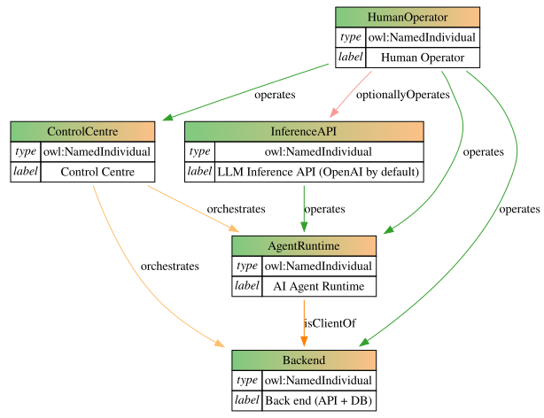

# KTP HCR Detour: AI Augmentation

> [!IMPORTANT]
> This document contains minimal AI-generated text and was primarily written by [@paveljee][paveljee]

A reproducible architecture for running an isolated AI agent against a task-oriented backend API.
The AI Agent Runtime pulls work from the Backend, uses an LLM Inference API to complete it, and pushes the result back. A Human Operator deploys, operates, and reviews the system through a Control Centre.
This is a **feature** in the KTP HCR project.

## Architecture

The architecture is described in [Acme][acme-1997]-ish terms,
the "ish" being due to the fact that
the description does not necessarily subscribe to Acme in full complete faith
but rather reuses some of the basic primitives from the 1997 paper.
A specific formal implementation,
perhaps at an even higher level of abstraction than Acme, is
the [RDF/Turtle file](./assets/hcr_augment_agent_architecture.drawrdf.ttl)
from which the below diagram was [programmatically derived][giacomociti-rdf2dot].



_Figure 1. Architecture of the AI Augmentation Detour of the KTP HCR Pipeline. `owl:NamedIndividual` indicates that each graph node is declared as an individually identifiable entity in the ontology._

**Abbreviations:** AI, artificial intelligence; API, application programming interface; DB, database; HCR, [Highly-Cited Researcher][clarivate-hcr]; KTP, [Knowledge Translation Program][ktp]; LLM, [large language model][google-kg-llm]; OWL, [Web Ontology Language][owl2]; RDF, [Resource Description Framework][rdf11].

----

The architecture contains five **components** (Figure 1).

* **Human Operator** — operates
  the Control Centre, AI Agent Runtime, and Backend.
  The operator may also operate the Inference API when it is self-hosted.
* **Control Centre** — orchestrates
  the AI Agent Runtime and Backend.
* **AI Agent Runtime** — runs
  the agent and acts as an API client of the Backend.
  OpenAI Codex is used as the agent in this set-up.
* **LLM Inference API** — provides
  large language model (LLM) inference to the AI Agent Runtime.
  OpenAI is the default provider (some alternatives: OpenRouter, Ollama).
* **Backend** — exposes
  the task API and stores application data, logs, and submissions.

The AI Agent Runtime and Backend must be deployed as separate systems.
The AI Agent Runtime must not run on the Control Centre host
except as a guest virtual machine (VM, e.g., Lima on macOS).
The Backend may run on the Control Centre host or on another server,
but it must not run inside the AI Agent Runtime.
Note, however, that this particular implementation
([lifecycle](#lifecycle) below)
explicitly co-locates the Backend API and the Control Centre
on the same host machine, for example, by relying
on local Inter-Process Communication and
on the Lima-guest-on-a-macOS-host assumption.
A deployment placing the Backend API on another machine
must therefore provide an alternative implementation,
adapting the lifecycle description as necessary.

The LLM Inference API accesses the Backend API by operating the AI Agent Runtime;
more precisely, the API calls are invoked by the Runtime itself
whereas generative outputs of _some_ of these calls trigger tools on the Runtime
as in routine [LLM function calling][openai-function-calling].

The LLM Inference API and the AI Agent Runtime are
not authorized to access the Backend proper
except via the exposed Backend API.

Neither the LLM Inference API
nor the AI Agent Runtime is
authorized to access the Control Centre.

The specific **component properties**,
**component ports**, and **component port properties**
as well as the **connectors** and **connector roles**
to complete the Acme-ish description of 
the **system** architecture of the feature
are prescribed in the feature [lifecycle](#lifecycle) below,
where the descriptions are given as
[Gherkin][gherkin-docs]-ish **scenarios**.
A lower-level **representation** of these
as Python `Protocol`s is available from
`src/detours/detour_ai_augment/protected/src/architecture.py`
(hereafter referred to simply as the detour’s `architecture.py`).

Some underlying terminology that
emerged in the development process,
helpful to distinguish in the code base:

* A `Run`
  (exemplified by the
  `ControlCentreComponent.RunProperty`
  Python `Protocol` in
  the detour’s `architecture.py`)
  is what the Human Operator launches
  (either manually
  or through the Control Centre)
  as an act of HCR researcher card augmentation.
  A `Run Outcome` (Request), in particular,
  is an event that the Human Operator
  (or the Control Centre)
  triggers on the Backend 
  to signify the completion of a `Run`.
  In that sense,
  a `Run` remains a Control Centre-side concept
  while a `Run Outcome` (Request) is
  something that the Backend learns about
  (from the Control Centre),
  `Record`s (see below), and
  responds to.
* An `Attempt`
  (exemplified by the
  `AgentRuntimeComponent.BackendPort.AttemptProperty`
  Python `Protocol` in
  the detour’s `architecture.py`)
  represents what the AI Agent Runtime
  attempts to accomplish
  through its interaction with the Backend API
  (there may be
  and often are
  multiple `Attempt`s in a single
  AI Agent Runtime session).
  On the Backend side,
  this is merely an alias of the
  `Validate` (Request) event 
  that concludes the
  AI Agent Runtime’s submission process.
* A `Record`
  (exemplified by the
  `BackendComponent.AiAugmentHttpRequestLogRecordProperty`
  Python `Protocol` in
  the detour’s `architecture.py`)
  is something the Backend documents.
  This includes
  both `Run`- and `Attempt`-related interactions
  (both Requests and Responses) with the
  Control Centre and the
  AI Agent Runtime, respectively.

## Lifecycle

> [!NOTE]
> The Human Operator acts either manually
> or via orchestration through the Control Centre.
>
> **Corollary.**
> The Backend API is
> agnostic to the identity of who started it:
> be it the Human Operator manually or
> through the Control Centre
> (e.g., through its dashboard module).

> [!NOTE]
> The detour supports both
> interactive (e.g., in the chat interface of the [OpenAI Codex Visual Studio Code Extension][codex-vsce])
> and non-interactive (e.g., `codex exec`) OpenAI Codex sessions.

> [!NOTE]
> In this AI Agent Runtime,
> the [Multi-agent mode][openai-multi-agent]
> is disabled.

> [!IMPORTANT]
> The Backend API keeps its HTTP error messages
> opaque to the client and instructs the client
> to contact the Human Operator;
> it shows detailed, differentiated error messages
> to the Human Operator in the server logs.

> [!IMPORTANT]
> Before returning any `GET /pull` or `POST /push` response,
> the Backend API validates the complete exchange against
> the `HttpRequestLogRecord(schema_version="1.1")` Pydantic model.
> If valid, the Backend API issues a UUIDv7 `record_id`,
> serializes, appends, and `fsync`s the validated record to
> `AiAugmentBackendContext.replay_log` through one shared function,
> which private commit requests also use;
> else the Backend API `exit(1)`s loudly.
> Likewise, this is the Backend's Inter-Process Communication
> module's behaviour when serving any `POST /completed`,
> `POST /failed`, or `POST /cancelled` response.

> [!IMPORTANT]
> Before each use of the detour DuckDB database, 
> the Backend API synchronizes it by projecting
> every unprojected replay-log record in append order
> or `exit(1)`s loudly in case of any error.

1. The Human Operator provisions or starts the AI Agent Runtime.
1. At provisioning, the Human Operator starts an `appendwatch` daemon as a root user on the guest machine on which the AI Agent Runtime is running. This daemon monitors data integrity of rollouts in the Codex sessions directory and writes findings into the `APPENDWATCH_REPORT`, unavailable to the AI Agent Runtime.
1. At provisioning, the Human Operator issues one host-held SSH (Secure Shell) protocol credential at `AIVM_KEY_DIR` for own use downstream to connect to the AI Agent Runtime. Its public key is authorized on the guest machine separately for the ordinary account used by the AI Agent Runtime and for the restricted read account (`aivm-audit`) used by the Backend API to snapshot the `appendwatch` report and Codex session rollouts.
1. At provisioning, the Human Operator connects to the AI Agent Runtime using the SSH credentials and ensures that `OPENALEX_API_KEY` is exported as an environment variable on the guest machine on which the AI Agent Runtime is running. This guest key is provided exclusively for availability to the AI Agent Runtime; the Backend API receives `OPENALEX_API_KEY` at startup from the Human Operator instead (as such, do not assert equality of the guest and host `OPENALEX_API_KEY`).
1. The Human Operator starts the Backend API such that the Human Operator may write to the Backend API's stdin. This will be necessary downstream for communicating the Codex session UUID. Also, at startup, the Human Operator passes the path to the previously provisioned SSH credential so the Backend API has the necessary read accesses on the guest machine on which the AI Agent Runtime is running. Also, at startup, the Human Operator selects a highly-cited researcher (HCR) `ktp.namekey` to augment (e.g., `{"ktp.first_name": "A.", "ktp.last_name": "Sheikh"}`) and passes it to the Backend API as an environment variable. Also, at startup, the Human Operator passes the following environment variables to the Backend API: `APPENDWATCH_REPORT` path on the guest machine; Codex sessions directory path on the guest machine. The Human Operator may start the Backend API manually. Alternatively, the Human Operator may start it using the dashboard module of the Control Centre.
1. At startup, the Backend API applies a `fcntl.flock` to itself or exits on error. This ensures that only one instance of the Backend API can be running at the same time, which the downstream steps assume.
1. At startup, the Backend API proves in the server logs that both the `APPENDWATCH_REPORT` path and the Codex sessions directory path are readable to it on the guest machine.
1. At startup, the Backend API establishes a read-only connection to the main pipeline database, looks up the namekey passed prior, and selects the corresponding `ktp.innerdicts`.
1. At this point, the Backend API has all the information it needs to configure downstream `GET /pull` endpoint access for the AI Agent Runtime, so it does it. At startup, the endpoint must respond `200 OK` or `500 Internal Server Error` in case of any error.
1. Given the Human Operator started the dashboard module of the Control Centre, the module establishes a read-only connection to the main pipeline database, fetches `SourcePopulationRow`s and the linked information, and makes the namekeys differentially available for queuing depending on the `IneligibilityCategory` in its NiceGUI user interface.
1. As for the connection to the detour database, the Backend API always owns it for both reading and writing. Therefore, the dashboard module of the Control Centre only executes SELECT queries towards the detour DB by Inter-Process Communication to the Backend API. For this, the Backend API exposes a Unix socket through a separate Flask application that is unrelated to the FastAPI application serving the Backend API logic except for the fact that they share the detour DB connection and the workflow state. The Unix socket does not require authentication from the Control Centre because it is private to the host machine and inaccessible to the AI Agent Runtime anyway.
1. The Human Operator may start the Backend only in the Inter-Process Communication mode, that is, only the Flask application without the FastAPI Backend API.
1. At startup, the dashboard module of the Control Centre detects but does not query an independently running full Backend API or Inter-Process Communication-only Flask application.
1. The dashboard module of the Control Centre renders a button that repeats detection of the Backend and its mode and queries the Flask application through the Unix socket, which refreshes data in NiceGUI's `app.storage.general`.
1. To queue a namekey, and given the NiceGUI user interface is properly configured as described above, the dashboard module of the Control Centre maintains the queue in NiceGUI's `app.storage.general`. The queue is local to the dashboard module, persists beyond dashboard module restarts, but never enters the replay log – detour DB dynamics owned by the Backend API downstream; this honours above-mandated Backend API agnosticism with regard to the identity of who started it.
1. Given it is a queued namekey's turn to run, and given the AI Agent Runtime is up, and given the Backend API is down, and given no Codex processes are running on the guest machine on which AI Agent Runtime is running, the dashboard module of the Control Centre configures and starts the Backend API. Then the dashboard module of the Control Centre starts a non-interactive Codex session within the running AI Agent Runtime as described below. The dashboard module of the Control Centre then monitors the Codex process it started. When the Codex process exits, the dashboard module of the Control Centre queries the detour DB through the Backend-owned and exposed Unix socket; if it finds an accepted attempt for that Codex session, the run outcome is complete; else it is failed. A Human Operator cancellation of the current run, initiated through the GUI of the dashboard module of the Control Centre at any time, makes the run outcome cancelled. Before recording any of these three mutually exclusive outcomes of a Control Centre run and before winding down the Codex or Backend processes the dashboard module of the Control Centre started, the dashboard module of the Control Centre sends the corresponding HTTP request described below to the Backend Unix socket for persistent logging in the Backend's `AiAugmentBackendContext.replay_log`. It then records the run outcome independently of the Backend Unit socket's HTTP response, and immediately winds down the Backend API and the Codex processes it started, if any, and any child processes. A Human Operator cancellation of a queued run whose turn to run has not come yet simply removes the queued run from the queue maintained by the dashboard module of the Control Centre.
1. Given the dashboard module of the Control Centre started the Backend API or given the dashboard module of the Control Centre started any processes within the AI Agent Runtime, and on any expected or unexpected exit of the dashboard module of the Control Centre, the dashboard module of the Control Centre gracefully winds down the Backend API and AI Agent Runtime processes it started and any child processes; for any non-catchable exits (e.g., SIGKILL), proper recovery must happen on restart.
1. Given the AI Agent Runtime is provisioned and has started, and given the Backend API has started and its `GET /openapi.json` responds `200 OK`, the Human Operator connects to the AI Agent Runtime using the SSH credentials issued above and initializes a new (interactive or non-interactive) Codex session.
1. The Human Operator initiates a request to the LLM Inference API by sending a prompt into the Codex session.
1. The Codex executable within the AI Agent Runtime therefore begins operation. The Codex executable within the AI Agent Runtime creates a session rollout file in the Codex sessions directory.
1. The Human Operator records the Codex session ID and passes the recorded session ID to the running Backend API's stdin. 
1. Therefore, the Codex session ID is not known to the Backend API at the time when the Codex executable within the AI Agent Runtime starts operation. The Backend API requires the Codex session ID to properly configure its `POST /push` endpoint downstream.
1. The AI Agent Runtime, operated by the LLM Inference API, retrieves a task (e.g., the HCR profile to augment) from the Backend API `GET /pull` endpoint. At this point, under a happy path, `GET /pull` responds `200 OK` with `Content-Type: application/x-ndjson; charset=utf-8` innerdicts for augmentation. Error codes: `500 Internal Server Error` for any error.
1. The AI Agent Runtime works on the task by dispatching sequential requests to the LLM Inference API while the Inference API triggers tools (e.g., Linux shell commands) on the Runtime at its discretion.
1. At some point during the rollout, the AI Agent Runtime is expected to push the result to the Backend API at `POST /push`. Of note, it is ultimately at the discretion of the LLM Inference API whether it chooses to.
1. Under the happy path, the Backend API responds to a push with `202 Accepted` and `Location: /pull`. Before responding, the Backend API changes its internal state to busy, which is important downstream. Also, before responding, the Backend API exposes `503 Service Unavailable` with `Retry-After: 1` at `GET /pull`. Error codes for a push: `409 Conflict` with `Location: /pull` if the Backend API was busy prior to receiving the request or if the client has not yet retrieved the current persisted pull; the latter conflict preserves Backend workflow state and requires the client to retrieve `GET /pull` before resubmitting. Any other error produces `500 Internal Server Error`.
1. Given the accepted push record is persisted, the Backend API reads the session ID from stdin and uses the previously provisioned SSH key's `aivm-audit` authorization to copy the corresponding Codex rollout file from the guest machine to `AiAugmentBackendContext.rollout_cas_dir`, addressed by SHA-256 and recorded with its byte size and line count; of note, the Backend API trusts stdin to supply the Codex session UUID corresponding to the accepted push (the one-to-one exact corresponding rollout path is later resolved by the Backend API through the `aivm-audit` authorization of the provisioned SSH credential). If unsuccessful, the Backend API exposes `500 Internal Server Error` at `GET /pull`.
1. Given the rollout file is successfully accessible by its hash from `AiAugmentBackendContext.rollout_cas_dir`, the Backend API uses the previously provisioned SSH key's `aivm-audit` authorization to read the bitwise exact contents of the `APPENDWATCH_REPORT` file as bytes into a variable. If unsuccessful, the Backend API exposes `500 Internal Server Error` at `GET /pull`.
1. Given the `APPENDWATCH_REPORT` has been read, the Backend API prepares but does not send `POST http://invalid/commit`. This is represented by this `HttpRequestLogRecord` shape: `{"schema_version":"1.1","record_id":"<new UUIDv7>","method":"POST","scheme":"http","host":"invalid","port":null,"ready_to_respond_at_unix_usec":<backend time when commit request record is constructed>,"path":"/commit","query":"","request_headers":{"SourceKey":"ktp.filename=\"<original rollout filename>\", ktp.fragment;type=\"line_number\";line_number=\"<rollout snapshot line count>\"","NameKey":"ktp.first_name=\"<first name>\", ktp.last_name=\"<last name>\""},"request_body":{"pull_record_id":"<current pull UUID>","push_record_id":"<accepted push UUID>","codex_session_record":{"codex_session_id":"<Codex session UUID>","codex_rollout_record":{"sha256":"<SHA-256>","size":<rollout snapshot byte size>,"line_count":<rollout snapshot line count>},"appendwatch_report_record":{"encoding":"base64","data":"<base64 appendwatch report bytes>"}}},"response_code":null,"response_headers":null,"response_body":null,"received_at_unix_usec":null,"duration_usec":0}`, where the `NameKey` request header refers to the namekey previously passed by the Human Operator as an environment variable; the `SourceKey` request header uniquely identifies the section in the rendered researcher card that refers to the snapshotted state of the Codex session rollout. Note that the request headers are intended as convenience dictionaries of key metadata and in principle are fully derivable from the data resolvable from the request body.
1. The Backend API appends and `fsync`s the commit request through the shared replay-log function. This completes commit. Note that logging of pull and push events and taking a snapshot of the rollout and the appendwatch report precede and are in fact prerequisites to start a commit; post-commit validation follows the completion of a commit. If a commit is ever unsuccessful, the Backend API `exit(1)`s loudly.
1. Given commit has completed, the Backend API invokes post-commit validation. The validation function resolves the committed pull and push from the detour DuckDB database, verifies the rollout SHA-256, byte size, and line count, and parses the rollout filename and Codex session ID. It requires the committed `SourceKey` to match the referenced rollout and the committed `NameKey` to match the referenced pull. The validation function also decodes the committed appendwatch report, requires exactly one report leaf whose filename equals the committed `SourceKey`'s `ktp.filename`, and rejects a missing or duplicate leaf, a `COMPROMISED` leaf, or a `COMPROMISED` ancestor. The report itself is therefore the durable appendwatch validation result; no separate appendwatch response is persisted. Given appendwatch validation passed, the post-commit validation function selects the `Submission` Pydantic model until all narrative values and evidence have been accepted; thereafter it selects the `StandardizedSubmission` Pydantic model for pushes in that original-pull chain. A Pydantic-schema rejection can produce a `200 OK` Markdown pull without publishing the standardized retry contract, so that pull alone does not change the required model. The function validates the committed push against the selected Pydantic model as well as against the committed rollout. Post-commit validation ends by making its result available at `GET /pull`. A failure of validation against the Pydantic model or against the rollout content makes appropriate resubmission instructions available as `200 OK` with `Content-Type: text/markdown; charset=utf-8`; this pull therefore becomes the pull referenced by the next push; the Backend API also makes the `POST /push` endpoint available for submission again. Retry guidance states the current exact-match count separately from any persisted retry-contract violations; every reported violation remains independently blocking even when all current evidence items exactly match the archived rollout. Any other failure, including appendwatch `COMPROMISED`, makes a `500 Internal Server Error` available; the preceding `202 Accepted` push response remains unaltered. Successful validation writes the validated innerdict into the detour DuckDB database for the namekey-sourcekey pair, including `ktp.ai_augment_commit_record_id` containing the commit's UUIDv7 and, immediately after it, `ktp.ai_augment_commit_request_body` containing the request body of the commit. These fields therefore appear in the rendered researcher card in that order. Successful validation also makes `410 Gone` available at `GET /pull` with `Content-Type: application/x-ndjson; charset=utf-8`. The first response line is the accepted innerdict; the optional second line is ground truth.
1. When replayed, a persisted `410 Gone` pull response reconstructs the final innerdict and links it to the pull, push, commit, rollout, and appendwatch report.
1. The rollout continues until the AI Agent Runtime hits a `410 Gone` response at `GET /pull`, as triggered by the LLM Inference API. The response instructs the AI Agent Runtime to stop operation and remain idle until rehydrated by the Human Operator. Of note, it is ultimately at the discretion of the LLM Inference API when it chooses to stop operation.
1. Before the Human Operator or the dashboard module of the Control Centre ends or kills the Codex or Backend processes it started, it sends an empty-body `POST /completed`, `POST /failed`, or `POST /cancelled`, as appropriate, to the Backend's Flask Unix socket, owned by the Inter-Process Communication module of the Backend. Before responding, and if the session is known, the Inter-Process Communication module of the Backend takes a fresh content-addressed rollout snapshot, reads the current appendwatch report bytes, and appends the complete actual HTTP exchange to the authoritative replay log. Once logged, this is represented by this `HttpRequestLogRecord` shape: `{"schema_version":"1.1","record_id":"<new UUIDv7>","method":"POST","scheme":"http","host":"invalid","port":null,"ready_to_respond_at_unix_usec":<backend time immediately before responding>,"path":"<run outcome path as above>","query":"","request_headers":{"NameKey":"ktp.first_name=\"<first name>\", ktp.last_name=\"<last name>\""},"request_body":null,"response_code":<200 or 500 as described below>,"response_headers":<present only when a rollout was captured or else null: {"SourceKey":"ktp.filename=\"<original rollout filename>\", ktp.fragment;type=\"line_number\";line_number=\"<current rollout snapshot line count>\""}>,"response_body":{"pull_record_id":"<current pull UUID if available or else null>","push_record_id":"<accepted push UUID if available or else null>","codex_session_record":{"codex_session_id":"<Codex session UUID if known or else null>","codex_rollout_record":<if captured or else null: {"sha256":"<SHA-256>","size":<current rollout snapshot byte size>,"line_count":<current rollout snapshot line count>}>,"appendwatch_report_record":<if captured or else null: {"encoding":"base64","data":"<base64 current appendwatch report bytes>"}>}},"received_at_unix_usec":<backend time when request received>,"duration_usec":<backend duration from received to ready to respond>}`. A complete session, rollout, and appendwatch capture returns `200 OK`; a partial capture returns `500 Internal Server Error`, whose exchange is itself logged while authoritative logging remains operational. These run outcome records are archival: replay projects them only into raw HTTP history, without post-commit validation or researcher-output mutation, and `GET /query` returns them.
1. The dashboard module of the Control Centre displays the Backend snapshot savedness separately from its complete, failed, or cancelled run outcome and decodes the persisted appendwatch bytes into a display-only session status.
1. The Human Operator reviews Backend logs and submissions and repeats or adjusts the lifecycle as necessary.
1. The full AI Agent Runtime lifecycle is therefore limited to a single configured HCR profile.
 
<!---RETIRED, DO NOT USE
(BUT DO NOT DELETE)

Multiple tasks (e.g., HCR profiles) may be passed by the Human Operator to the AI Agent Runtime in a single batch; in this instance the rollout is expected to continue and only trigger a `410 Gone` response once the batch is exhausted.--->

## Directory contents and lockfile

This section is intended to capture the specifics of the detour operation in sufficient detail to be reproduced.

> [!NOTE]
> Note that the behaviour of the LLM Inference API, unless self-hosted and specially provisioned (not by default), is fundamentally irreproducible. As such, it is only recorded as observed as an audit trail (e.g., as a OpenAI Codex JSON Lines rollout).
>
> The decision not to self-host an LLM Inference API was driven by the fact that the augmentation pipeline depends heavily on web search and web page retrieval, which are inherently irreproducible as usually implemented. For example, the open source [Tongyi Deep Research][tongyi] pipeline, while supporting open-weight models, still relies on third-party services such as Serper for web search or Jina for web page retrieval, substantially relaxing end-to-end reproducibility guarantees in general. Additionally, frontier agentic set-ups such as OpenAI Codex often offer [superior][artificial-analysis-coding-agents] performance on tasks such as software engineering, as well as across the board.

> [!IMPORTANT]
> The detour root tree is organized in a conventional way:
>
> - `./src/` contains the source code;
> - `./tests/` contains tests and fixtures;
> - `./assets/` contains static media.
>
> That said, some files reside in the `./protected/`
> subdirectory. It mirrors the root tree and
> hosts files that are maintained with
> **an elevated level of care and scrutiny**
> and/or were heavily edited or reviewed manually.
> **Extra discretion is advised before writing**
> **into `./protected/`.**

**Control Centre:** Requires no specialized infrastructure beyond a computer capable of operating the detour components, including sufficient computing resources and internet access. The test set-up (hereafter: the main host) used a Mac16,12 Macbook Air (Apple M4 chip) in a 10-core, 24 GB RAM, 512 GB SSD configuration, running macOS Sequoia 15.6.1 and Visual Studio Code 1.130.0, though these versions were not pinned and may have been updated moving forward.

**Backend:** Deployed on the host machine using `./src/backend/server.py` in this (i.e., the `detour_ai_augment` “detour” of the KTP HCR pipeline) environment.
`pixi.lock` and `pyproject.toml` in the repository root provide the pinned Python config.
The version of pixi is locked in `.tool-versions`.

**AI Agent Runtime:** Deployed under the main host to a [Lima virtual machine version 2.2.0][lima220] using `./protected/src/agent_runtime/deploy.sh`.

More needs to be said about the Control Centre – AI Agent Runtime dynamics, so there is a separate section dedicated to this down below.

## Replay log
Along with Codex rollout blobs from the
detour’s Content-Addressable Storage (CAS),
this serves as the single-source-of-truth artifact
documenting one or multiple Backend launches.

Some non-obvious technical details are noted below.

### Timing rules

| Object | `received_at_unix_usec` | `ready_to_respond_at_unix_usec` | `duration_usec` |
|---|---|---|---|
| Pull/Push/Query/RunOutcome **RequestRecord** | Request receipt | `None` | `0` |
| Corresponding **ResponseRecord** | `None` | Response ready | Response ready − request receipt |
| Init/Commit/Validation | `None` | Construction time | `0` |
| Outgoing OpenAlex/ROR request | `None` | Dispatch time | `0` |
| Received OpenAlex/ROR response | Arrival time, captured immediately after `send()` returns | `None` | `response.elapsed` in microseconds |

## Known failure modes
### Out of disk space
If the machine on which the AI Agent Runtime is running
runs out of disk space during `codex` execution,
the rollout may be corrupted or partially lost.

### Control Centre vs. AI Agent Runtime – Harnessing software that also has agency
As described above, the AI Agent Runtime is co-operated by the Human Operator and the LLM Inference API.
While the Human assumes a more supervisory role, principal operations are undeniably handed over to the LLM Inference API.
This status quo is peculiar because this AI Agent Runtime both orchestrates and authorizes tool calls such as Linux shell commands.
Note that this Runtime authorizes OpenAI Codex to run in the `danger-full-access` sandbox mode, which means unrestricted access to the (virtual) machine on which and under which user the executable is running.
This authorization is helpful to ensure stable autonomous work of the Runtime, which is contingent on its ability to execute any commands as generated by the LLM Inference API.

This peculiarity is immediately visible if we consider how Unix Discretionary Access Control (DAC) privileges work for the Runtime.
Tool calls are invoked by an executable that interacts with the LLM Inference API, e.g., an OpenAI Codex binary.
The executable, in turn, runs under permissions that were bestowed upon it by the Human Operator.
These permissions are inherited by the tool calls that the executable initiates.
For example, it turns out to be difficult to have the executable both write the session log into a file while at the same time restricting the executable from tampering with the file using LLM-generated shell commands.

This effect on the session log is particularly unfortunate because it forces the Human Operator to regard it as an untrusted artifact _despite_ its being generated by a deterministic process, _specifically_ due to the fact that the Runtime may in principle tamper with the artifact in retrospect by leveraging its tool calling capabilities.

This vulnerability was countered by the Control Centre implementing a series of measures:

- The deployment script `./protected/src/agent_runtime/deploy.sh` provisions a non-root user account under which VS Code Server and Codex extension are installed and executed. This effectively limits the scope of system permissions, such as passwordless sudo.
- Before launching Codex, under a root user (inside the virtual machine), a watcher `./protected/src/control_centre/appendwatch/appendwatch.py` is running that monitors events within the `$CODEX_HOME/sessions` directory, where the Codex app stores session logs.
The watcher tracks changes applied to session files using `inotify` and permanently flags any rollouts on which non-append-only changes were observed.
- Both the watcher and the report it maintains are persisted beyond Codex’s user account (i.e., only authorized under root; the report is also authorized under the `aivm-audit` account), placing them out of reach of the AI Agent Runtime.

Programmatic measures on the Control Centre’s end are supplemented with measures for which the Human Operator is responsible:

- The report directly informs review of AI Agent Runtime submissions on the Backend: rollouts marked as compromised are tracked down to the corresponding submissions and invalidate them.
- **As an important closing step, the human operator must review the session chat (i.e., as rendered by the VS Code extension), including any collapsed sections, before closing the Codex session to spot any obviously suspicious tool calls.** This step might be the most difficult to tamper with, as, upon adversarial testing, even if the underlying rollout is compromised, the already-rendered chat is not replaced _unless_ VS Code/the extension is restarted.

The probability of rollout compromise is estimated to be quite small, but it is [non-zero][gh-issue-rollout-self-ingest].
In contrast, the defensive measures in place tentatively establish session rollouts as _trusted_ artifacts, enabling their downstream use, for example, as a faithful record of web search tool outputs.

## Note on self-hosting LLM Inference API
This specific set-up has been tested, to a degree, for the feasibility of reproducing it with a self-hosted LLM Inference API instead of OpenAI.

> [!NOTE]
> On 2026-10-31 UTC,
> an attempt was made
> to use the production
> AI Agent Runtime to
> re-log in using an OpenAI API key
> and change the Codex model to 
> `gpt-oss-120b`, but it was not
> supported nor shown among the
> supported `/v1/models`.
> It was therefore impossible to
> attempt runs using an open-weight
> model while also using the native
> OpenAI's Codex `web.run` namespace
> that is required by this detour's
> Codex rollout parser.
> Third-party providers who would
> serve an open-weight model while
> also providing a fully compatible
> `web.run` endpoint were also not
> found online.
> Serving the endpoint on our own
> and/or rewriting the rollout
> parsing logic would be a 
> considerable additional 
> undertaking that, at the time,
> would be out of scope.

**Takeaway: The KTP HCR AI Augmentation detour architecture ([Figure 1](#architecture)) can be successfully deployed and run as documented using a self-hosted LLM Inference API instead of OpenAI.**
Caveat: Provisioning a separate web search / web page retrieval service (e.g., Serper or Jina, respectively) would be necessary, and some of the intended Codex tooling would not work (or would not work as expected).
This caveat was an important reason behind the decision to go with OpenAI on this project despite the vendor lock and token-for-token irreproducibility in the long run as older models get deprecated by the provider – coupled with the expected overall better performance of a frontier LLM such as GPT-5.6-Sol over a smaller self-hosted model, and considering the generous Codex usage allowance coming with ChatGPT Plus pricing (e.g., CA$28.24/month inclusive of applicable taxes as of August 2026).

Another caveat:

> [!NOTE]
> `base_instructions` Codex CLI exposes
> may be completely different
> when run with GPT versus a custom provider. 

To smoke-test the feasibility of using a self-hosted LLM Inference API in this detour, on August 6^th^, 2026, UTC-4, a Human Operator completed the following steps:

* Deployed a virtual machine using `src/detours/detour_ai_augment/protected/src/agent_runtime/deploy.sh` under [Lima 2.2.0][lima220] under an arm64 macOS host as [specified above](#directory-contents-and-lockfile).
* SSH’d into it  as `$AIVM_USER` and opened a session with GNU bash version 5.2.21(1).
* Installed a standalone instance of codex-cli `VERSION="0.146.0-alpha.3.1"` using this command: `curl -fsSL https://chatgpt.com/codex/install.sh | sh -s -- --release "$VERSION"`

    * **Note** that the version of codex-cli **may and does** differ for codex-cli as used in this detour and as used for AI-assisted coding. The latter is best documented under this repository's `.codex/config.toml`. This is **important** because there **may be and are** multiple differences between codex-cli versions.

* Logged in using Human Operator’s ChatGPT Plus credentials.
* Note that the `~/.codex/config.toml` file was automatically picked up as provisioned at deploy from `src/detours/detour_ai_augment/protected/src/agent_runtime/provision.sh`.
* Replaced the `model` definition in `config.toml` with the following:

    ```toml
    model = "default"
    model_provider = "llamacpp"

    [model_providers.llamacpp]
    name = "llama.cpp"
    base_url = "http://192.168.5.2:8000/v1"
    wire_api = "responses"
    requires_openai_auth = false
    ```
* On the macOS host, downloaded one of the latest llama.cpp releases, which was [b10295][llamacpp-b10295] at the time, for macOS ARM64 (`llama-b10295-bin-macos-arm64.tar.gz`), optimized for the [Metal backend][llamacpp-kleidiai-disabled-pr].

    > [!NOTE]
    > Some of the earlier releases did not support all Codex features used in this set-up, for example, `"name":"run","namespace":"web"` for `function_call`’s, which is relied on _heavily_ when validating submissions in `src/detours/detour_ai_augment/src/backend/api.py`.
* Removed macOS Gatekeeper’s quarantine on the downloaded package to enable execution: `LLAMA_RELEASE="10295" && /usr/bin/xattr -d com.apple.quarantine "$HOME/Downloads/llama-b${LLAMA_RELEASE}-bin-macos-arm64.tar.gz"`
* Deployed llama.cpp on the macOS host. A sample deployment, particularly llama.cpp configurations used, is documented here: `src/detours/detour_ai_augment/protected/src/llm_inference_api/sample_deploy/`
    * Note that llama.cpp was deployed in a non-router mode, hence the `default` model name in `config.toml` above.
    * Note also that the proxy server that is used there is completely optional and provided for illustrative purposes.
* On the macOS host, launched the detour Backend API (i.e., using `pixi run serve`).
    * Note that a non-default port (e.g., `8612`) was used for the Backend API so as not to collide with the default `8000` port on which the self-hosted LLM Inference API would already be running in this set-up.
    * Note also that the `aivm-appendwatch` service, responsible for continuously verifying the integrity of Codex rollouts, would also have been provisioned already and running by that point as part of the AIVM deployment process.
    * A helpful command to monitor `appendwatch` statuses on AIVM is this (to be run under a root user): `MOUNT_DIR=/path/to/mounted/dir/on/macos && watch --interval=1 cat "$MOUNT_DIR/.aivm-control/appendwatch/appendwatch-tree.txt"`
* Codex CLI was prompted in a non-interactive mode: `codex exec --skip-git-repo-check "http://192.168.5.2:8612/openapi.json"`
    * Note that the URL here is _the_ prompt.

Two sample rollouts from these runs are provided for reference from these runs at `src/detours/detour_ai_augment/protected/src/llm_inference_api/sample_rollouts`:

* `gemma-4-e4b-it-Q4_K_M-reasoning-off.jsonl` documents the performance of [Gemma 4 E4B][google-gemma-4-model-card] (in the `ggml-org/gemma-4-E4B-it-GGUF` variant, as of [commit 6b352c5][gemma-4-E4B-it-GGUF-6b352c5], `Q4_K_M` quantized) with reasoning turned off; 
* `gpt-oss-20b-mxfp4-reasoning-high.jsonl` documents the performance of [GPT OSS 20B][arxiv-gpt-oss-model-card] (in the `ggml-org/gpt-oss-20b-GGUF` variant, as of [commit e1dc459][gpt-oss-20b-GGUF-e1dc459], `MXFP4` quantized) with reasoning set to `high` (in the llama.cpp server config; the value from `config.toml` was ignored).

See the exact llama.cpp server configurations used for both models at `src/detours/detour_ai_augment/protected/src/llm_inference_api/sample_deploy/`

The rollouts can be reviewed with this tool: `src/github.com/simonw/tools/blob/266b40cbefe398ec5a03b695f107cab7a5713529/codex-timeline.html`

Note that the runs were done on a “dirty” virtual machine (i.e., an AIVM instance already provisioned earlier), hence the documented GPT OSS’s behaviour when it detected unrelated files in the working directory.

## Production runs
### 2026-11-02

```shell
#!/bin/zsh

# ===============================================
# KTP RI pipeline: AI augmentation detour.
# Production runs on 2026-11-02 UTC-5.
# All commands are shown as run; illustrative
# commands are all shown as comments only.
# As such, this is not supposed to run end to end
# if launched but rather is a report. Overall, this
# does not represent an excrutiatingly verbose
# log of all events as they happened; these are
# condensed for narrative purposes. The report as
# written is intended to be reproducible, though.
#
# Note that this deploy still requires the Internet
# and some online sources like Conda repos to be
# available online; it's not fully localized.
# ================================================

git clone https://github.com/paveljee/2026-01-02_enrich_full_df.git

# Then done this via GUI:
# mv ~/2026-01-02_enrich_full_df ~/2026-01-02_enrich_full_df_20261102
cd ~/2026-01-02_enrich_full_df_20261102

# Merged aicode/feat/detour-ai-augment into main via a GitHub PR.
git pull
git show HEAD
# commit 3200cf03e29f3387bce324ddf34f5d201a3aea9b (HEAD -> aicode/staging, origin/aicode/staging, origin/HEAD)
# Merge: ac81b44 d88f13c
# Author: Pavel Zhelnov <pzhelnov@p1m.org>
# Date:   Mon Nov 2 09:12:26 2026 -0500
#
#     Merge pull request #21 from paveljee/aicode/feat/detour-ai-augment
#    
#     Ready for merge: aicode/feat/detour-ai-augment branch
#    
#     - All tests green under `pre-commit-operator`
#     - Replay logs merged over 5 test launches, over several days, and replayed successfully
#     - 6 random, eligible namekeys run via dashboard successfully, of
#     which one was missing ground truth
#     - A replay log demerged from the merged log and replayed successfully
#     - Data reviewed in dashboard and raw (cursorily at this point
#     because no new concerns were anticipated) and no issues that require addressing
#     - 11 namekeys prepared for the release batch 9 and ready to run
#     - All planned steps before the planned production runs are cleared,
#     ready to launch

# Prefer Linux over macOS for prod runs for reproducibility.
# Provision a fresh Lima instance while using some known
# image - just reuse the config we already have; resources
# there should be enough for everything:
mkdir ./tmp
export MOUNT_DIR_YAML="$PWD"
export GUEST_MOUNTPOINT_YAML="$MOUNT_DIR_YAML"
export LIMA_INSTANCE="detour-ai-augment-prod-20261102"
export LIMA_START_TIMEOUT="25m"  # as in deploy.sh
# The below are read-only mounts for config:
export SSN_V2="/Volumes/home/anonymous/sciscinet/v2/hf/xet"
export HCR_XLSX="/Volumes/Users/Anonymous/Workshop/202504161200UTC-4_Nancy_Baxter_Andrea_Tricco_collabs/2024-Historical-Highly-Cited-Researchers-lists - final"
export KTP_DOCX="/Volumes/Users/Anonymous/Workshop/202504161200UTC-4_Nancy_Baxter_Andrea_Tricco_collabs/analyses/2026-01-02_enrich_full_df/data/manual_extractions"
# Reuse some of heaviest artifacts from prebuilt prior:
export PIPELINE_HEAVY="/Volumes/home/aicode/2026-01-02_enrich_full_df/data/output"
# These lines cover the YAML template and start command:
sed -n '293,385p' src/detours/detour_ai_augment/protected/src/agent_runtime/deploy.sh | awk '
  /^param:/ || /^portForwards:/ || /^provision:/ { skip=1; next }
  /^EOF$/ { skip=0; print; next }
  skip && /^[^[:space:]#]/ { skip=0 }
  !skip && /^mountType:/ {
    for (i = 1; i <= 4; i++) {
      name = (i == 1 ? "SSN_V2" : i == 2 ? "HCR_XLSX" : i == 3 ? "KTP_DOCX" : "PIPELINE_HEAVY")
      print "  - location: \"$" name "\""
      print "    mountPoint: \"$" name "\""
      print "    writable: false"
    }
  }
  !skip { print }
' > ./tmp/start-lima.sh
which bash  # /opt/homebrew/bin/bash
bash --version  # GNU bash, version 5.3.8(1)-release (aarch64-apple-darwin24.6.0)
which limactl  # /opt/homebrew/bin/limactl
limactl --version  # limactl version 2.2.0
bash ./tmp/start-lima.sh  # success

# Log into the provisioned Lima instance and use it moving forward:
limactl shell detour-ai-augment-prod-20261102
which bash  # /usr/bin/bash
bash --version  # GNU bash, version 5.2.21(1)-release (aarch64-unknown-linux-gnu)

# Copy pipeline config to provide repro-friendly values:
# cp ~/2026-01-02_enrich_full_df_20261102/config_ai_augment.json ~/2026-01-02_enrich_full_df_20261102/config_ai_augment_prod_20261102.json
# Edited it via GUI, including new values obtained from 
# the below commands - will commit the config to repo.

# Copied via macOS (!) GUI the binary linux_arm64 duckdb extension
# splink_udfs v1.5.1 into the working directory:
# mkdir -p ~/.duckdb/extensions/v1.5.1/linux_arm64
# cp /Volumes/home/aicode/.duckdb/extensions/v1.5.1/linux_arm64/splink_udfs.duckdb_extension ~/.duckdb/extensions/v1.5.1/linux_arm64/splink_udfs.duckdb_extension
# cp /Volumes/home/aicode/.duckdb/extensions/v1.5.1/linux_arm64/splink_udfs.duckdb_extension.info ~/.duckdb/extensions/v1.5.1/linux_arm64/splink_udfs.duckdb_extension.info

# Did not redownload the SciSciNet v2 and Clarivate's HCR data
# because they are publicly available and the hashes were pinned.
#
# Also, I did not change the paths to the internal DOCX files and
# pipeline files like OpenAlex paper title and author search logs
# because they are expensive and unnecessary to rebuild; they are
# raw data that are shared as part of this repository anyway.
#
# I did reset the internal parquet files (specifically OpenAlex
# paper titles parquet and SciSciNet v2 unnested names parquet)
# to rebuild them from source JSONL.

# Created and hashed an empty file for each of:
# - AI augmentation detour's replay log
mkdir ./data/ai_augment
replay_log="./data/ai_augment/replay_log.jsonl" && touch "$replay_log" && sha256sum "$replay_log"
# - OpenAlex paper-title parquet
# no file creation is necessary - pipeline does this
# - SciSciNet v2 unnested names parquet
# no file creation is necessary - pipeline does this

# Download appropriate pixi binary:
PIXI_VERSION=$(awk '$1 == "pixi" {print $2; exit}' .tool-versions)
PIXI_TGZ="./tmp/pixi-aarch64-unknown-linux-musl-${PIXI_VERSION}.tar.gz"
PIXI_URL="https://github.com/prefix-dev/pixi/releases/download/v${PIXI_VERSION}/pixi-aarch64-unknown-linux-musl.tar.gz"
curl -fL -o "$PIXI_TGZ" "$PIXI_URL"
curl -fL -o "${PIXI_TGZ}.sha256" "${PIXI_URL}.sha256"
read -r PIXI_SHA256 _ < "${PIXI_TGZ}.sha256"
printf '%s *%s\n' "$PIXI_SHA256" "$PIXI_TGZ" | sha256sum -c -
# Reminder: Inside Lima VM.
# Install pixi:
mkdir -p ~/.local/bin
tar -xzf "$PIXI_TGZ" -C ~/.local/bin pixi
chmod +x ~/.local/bin/pixi
echo 'export PATH="$HOME/.local/bin:$PATH"' >> ~/.bashrc
source ~/.bashrc
pixi --version  # pixi 0.62.2
# Install pixi deps from lockfile:
rm -rf ./.pixi && pixi install --all --locked
# ✔ The following environments have been installed: default, detour-mode0-econ-stats, detour-ai-augment.

# Create config for main pipeline - different from detour's:
# cp ~/config_ai_augment_prod_20261102.json ~/config_repl_20261102.json
# Manually edited to update output path and remove
# the unsupported/unused keys - will commit this config.

# Add OpenAlex key in `.env`:
# cp ./.env.example ./.env
# Edited manually.

# Run the main pipeline using the new config:
pixi run python -m src.repl --config ./config_repl_20261102.json --new
# Note: Supply Yes manually in an interactive mode.
#
# =============== Attempt 1 ====================
# This failed to run because the resources were too small.
# So I decided to reuse the existing artifact given that
# its generation logic should not have changed in the slightest
# because it represents only a permutation on SciSciNet v2 data,
# and I will reserve the verification of this artifact for another
# time; it requires 20+ GB RAM and 20+ GB free disk space.
#
# =============== Attempt 2 ====================
# Then after restoring the path to `ktp_author_details_unnest`
# in the config, the same command failed again - this time due
# to a stale schema version check in `openalex.py`. I did not
# proceed to regenerate it, therefore, and reused the older
# artifact because this was a clear problem - a regression
# introduced during schema v1.1 implementation; it is fixable
# and does not affect the detour runs; it must be addressed
# separately therefore.
#
# =============== Attempt 3 ====================
# Reran again; success - last step's log lines:
#      Execution Metrics      
#                            
#   Metric           Value    
#  ────────────────────────── 
#   Peak RAM Usage   3.48 GB  
#   Cards            307      
#                            
# Execution Metrics
# Peak RAM Usage: 3.48 GB
# Cards: 307
# Diagnostics report saved to: 
# data/diagnostics/20261102_131723/repl_diagnostics.md
# Success! Output saved to: 
# data/output/2024-Historical-Highly-Cited-Researchers-lists - 
# final_combined_cards.zip
#
# =============== Follow-up ====================
# Manually changed the rights for the database file
# `scisci_process_20261102.duckdb` to read-only.
# 
# Some checks:
#
# - `diff -qr` of unzipped TXT outputs from output dir
#   against a run after git tag `detour-ai-augment-rc1`,
#   on 2026-10-28T1826Z, after normalizing the date of
#   report, exited 0, indicating they are identical;
# - Diffs (through VS Code's Select for compare/Compare
#   with selected feature) of the diagnostic artifacts
#   across these two same runs were unremarkable:
#    
#   step artifact `10_build_cards_card_partitions_df.csv`
#   and `repl_diagnostics.md` were the same, and the
#   `repl_session.log` only differed on timestamps and
#   RAM usage.
#
# All in all, these checks are the same as the usual
# gates that were used to establish the absence of
# main pipeline regressions across code iterations, so
# I interpret these as strong evidence of equivalence.

# The next step will be running the dashboard, which
# requires the macOS because the dashboard manages the
# Backend and the AI Agent Runtime (via Lima).
# Therefore, I had to quit Lima and use maCOS.

# As run on macOS, under Terminal, `/bin/zsh`:
rm -rf ./.pixi && pixi install --all --locked
# ✔ The following environments have been installed: default, detour-mode0-econ-stats, detour-ai-augment in '/Users/anonymous/Library/Caches/rattler/cache/envs'.

# Initialize AI Agent Runtime (on macOS):
export OPENALEX_API_KEY="$(pixi run python -c '
import os
from dotenv import dotenv_values
env_path = os.path.join(os.getenv("PIXI_PROJECT_ROOT"), ".env")
print(dotenv_values(env_path).get("OPENALEX_API_KEY", ""), end="")
')"
REPO_DIR="$PWD" bash src/detours/detour_ai_augment/protected/src/agent_runtime/deploy.sh
# Supply Yes manually when prompted.
# ✅ Lima instance created successfully
# ✅ SSH access to Lima jump host works
# Warning: Permanently added 'lima-aivm-ai' (ED25519) to the list of known hosts.
# ✅ SSH access to 'ai' through jump host works
# Warning: Permanently added 'lima-aivm-aivm-audit' (ED25519) to the list of known hosts.
# ✅ SSH access to 'aivm-audit' audit protocol works
# ✅ 'aivm-audit' rejects commands outside its read protocol
# ✅ Connected as 'ai'
# ✅ Home is '/home/ai'
# ✅ 'ai' has no passwordless sudo
# ✅ Project directory is mounted at '/Volumes/home/aicode/aivm/home/ai'
# ✅ Mounted project is writable for the Lima jump user at '/Volumes/home/aicode/aivm/home/ai'
# ✅ Mounted project is inaccessible to 'ai'
# ✅ Appendwatch is active and inaccessible to 'ai'
# ✅ Appendwatch report is readable only through 'aivm-audit' audit protocol
# ✅ Codex config exists at '/home/ai/.codex/config.toml'
# ✅ VS Code 1.130.0 installed
# ✅ VS Code extension openai.chatgpt@26.721.41059 installed
# ✅ Codex CLI 0.146.0-alpha.3.1 installed
# ✅ OPENALEX_API_KEY round-trips into the AIVM environment

# Log into Codex:
ssh lima-aivm-ai
codex auth
codex login status
# Logged in using ChatGPT

# Initialize Backend in IPC-only mode to hydrate dashboard:
# ============ Initialize full Backend ====================
# Note that OPENALEX_API_KEY above and these env vars are
# reused by Backend and Control Centre dashboard later.
export FASTAPI_DETOUR_DASHBOARD_SOCKET="/tmp/detour-manual-$(id -u).sock"
export FASTAPI_DETOUR_AIVM_IDENTITY_FILE="$HOME/.local/share/aivm/.ssh/id_ed25519"
export FASTAPI_DETOUR_NAMEKEY='{"ktp.first_name":"Gaoquan ","ktp.last_name":"Shi"}'  # any eligible key
export FASTAPI_DETOUR_APPENDWATCH_REPORT='"'"'/Volumes/home/aicode/aivm/home/ai/.aivm-control/appendwatch/appendwatch-tree.txt'"'"'
export FASTAPI_DETOUR_CODEX_SESSIONS_DIR='"'"'/home/ai/.codex/sessions'"'"'
pixi run -e detour-ai-augment python -m src.detours.detour_ai_augment.protected.src.backend.server --config ./config_ai_augment_prod_20261102.json --new --yes
# INFO:__main__:Starting Backend: config=config_ai_augment_prod_20261102.json; ipc_only=False; new=True; resume=False
# INFO:__main__:Loading Backend configuration/resources: config_ai_augment_prod_20261102.json; verify_hashes=True
# INFO:src.detours.detour_ai_augment.src.backend.helpers.data_models.ai_augment_context:Loading researchers from read-only source DB: data/scisci_process_20261102.duckdb
# INFO:__main__:Backend configuration and source validated: 307 researchers
# INFO:__main__:Starting Backend HTTP API at 127.0.0.1:8612
# INFO:     Started server process [49497]
# INFO:     Waiting for application startup.
# INFO:__main__:Opening writable Backend Store: new=True
# INFO:src.detours.detour_ai_augment.protected.src.backend.helpers.data_models.store:Replaying 0 lines (0 bytes) into new detour DB
# INFO:src.detours.detour_ai_augment.protected.src.backend.helpers.data_models.store:Replay complete; accepted hash e3b0c44298fc1c149afbf4c8996fb92427ae41e4649b934ca495991b7852b855 at line 0, byte 0
# INFO:src.detours.detour_ai_augment.protected.src.backend.helpers.data_models.store:Verifying replay log: stored hash e3b0c44298fc1c149afbf4c8996fb92427ae41e4649b934ca495991b7852b855 at line 0 byte 0; config hash e3b0c44298fc1c149afbf4c8996fb92427ae41e4649b934ca495991b7852b855; 0 bytes
# INFO:src.detours.detour_ai_augment.protected.src.backend.helpers.data_models.store:Verifying prefix: 0 lines, 0 bytes
# INFO:src.detours.detour_ai_augment.protected.src.backend.helpers.data_models.store:Prefix hash matches stored anchor
# INFO:src.detours.detour_ai_augment.protected.src.backend.helpers.data_models.store:DB/log ordinal and byte coverage verified: 0 lines, 0 bytes
# INFO:__main__:Writable Backend Store ready
# Dashboard IPC running on unix:///tmp/detour-manual-501.sock
# INFO:     Application startup complete.
# INFO:     Uvicorn running on http://127.0.0.1:8612 (Press CTRL+C to quit)
# ============ Update hash sum for replay log in config ====================
sha256sum ./data/ai_augment/replay_log.jsonl
# a2f639e28518e7a94b3b31777672b6e65b35c0b315e0e7ebe231564ab01d12af
# ============ Restart Backend as IPC-only ====================
# Press CTRL+C to quit
pixi run -e detour-ai-augment python -m src.detours.detour_ai_augment.protected.src.backend.server --config ./config_ai_augment_prod_20261102.json --ipc-only
# INFO:__main__:Starting Backend: config=config_ai_augment_prod_20261102.json; ipc_only=True; new=False; resume=False
# INFO:__main__:Loading Backend configuration/resources: config_ai_augment_prod_20261102.json; verify_hashes=True
# INFO:src.detours.detour_ai_augment.src.backend.helpers.data_models.ai_augment_context:Loading researchers from read-only source DB: data/scisci_process_20261102.duckdb
# INFO:__main__:Backend configuration and source validated: 307 researchers
# INFO:__main__:Opening read-only Backend Store
# INFO:src.detours.detour_ai_augment.protected.src.backend.helpers.data_models.store:Verifying replay log: stored hash e3b0c44298fc1c149afbf4c8996fb92427ae41e4649b934ca495991b7852b855 at line 0 byte 0; config hash a2f639e28518e7a94b3b31777672b6e65b35c0b315e0e7ebe231564ab01d12af; 428 bytes
# INFO:src.detours.detour_ai_augment.protected.src.backend.helpers.data_models.store:Verifying prefix: 0 lines, 0 bytes
# INFO:src.detours.detour_ai_augment.protected.src.backend.helpers.data_models.store:Prefix hash matches stored anchor
# INFO:src.detours.detour_ai_augment.protected.src.backend.helpers.data_models.store:Verifying suffix line 1
# INFO:src.detours.detour_ai_augment.protected.src.backend.helpers.data_models.store:DB/log ordinal and byte coverage verified: 1 lines, 428 bytes
# INFO:__main__:Read-only Backend Store ready; starting query-only IPC
# Dashboard IPC running on unix:///tmp/detour-manual-501.sock

# In a second Terminal, on macOS, run Control Centre dashboard:
# Re-supply these env vars in the new terminal.
export OPENALEX_API_KEY="$(pixi run python -c '
import os
from dotenv import dotenv_values
env_path = os.path.join(os.getenv("PIXI_PROJECT_ROOT"), ".env")
print(dotenv_values(env_path).get("OPENALEX_API_KEY", ""), end="")
')"
export FASTAPI_DETOUR_DASHBOARD_SOCKET="/tmp/detour-manual-$(id -u).sock"
export FASTAPI_DETOUR_AIVM_IDENTITY_FILE="$HOME/.local/share/aivm/.ssh/id_ed25519"
dashboard_log="logs/dashboard_runs_20261102.log" && script -a "$dashboard_log" pixi run -e detour-ai-augment python -m src.detours.detour_ai_augment.src.control_centre.dashboard.ui --config ./config_ai_augment_prod_20261102.json
# [control-centre] Starting Dashboard with config config_ai_augment_prod_20261102.json
# [control-centre] persisted Dashboard state restored
# [control-centre] queue worker ready
# [control-centre] ready at http://127.0.0.1:8611

# Web browser: Chrome for macOS,
# Version 156.0.8078.74 (Official Build) (arm64).
# Open the dashboard UI in the browser, press Query IPC.
# Popup: Dashboard query snapshot replaced

# Important! Press CTRL+C to quit to quit the Backend;
# else Control Centre dashboard queue processing will fail.

# In dashboard UI, press Probe.
#
# Backend API: unavailable
# IPC: unavailable
# Lima/SSH: available
# Codex/auth: available
# Probed: 2026-11-02T19:54:31+00:00
#
# Both the Backend API and IPC must be unavailable to
# allow the dashboard to manage Backend launches.

# Following `data/map_subset0_to_batch.csv`, find
# subset 9 namekeys by inputting the draw numbers
# in the UI search box, queue them. In fact, these
# all come in order if sorted by ktp.draw_number,
# ascending, and skipping pilots and ineligible.

# After queueuing, status bar:
# Total 307 · ground truth 207 · no ground truth 67 · ineligible 33 · ready 263 · queued 11 · running 0 · completed 0 · failed 0 · cancelled 0
# Press Start queue processing.

# After processing, status bar:
# Total 307 · ground truth 207 · no ground truth 67 · ineligible 33 · ready 263 · queued 0 · running 0 · completed 11 · failed 0 · cancelled 0
# Press Stop queue processing.

# Press Query IPC.
# Press CTRL+C to quit to quit the dashboard.

# Some artifacts:
# - 27513d592af66d73442c8958d95a3393701d9b5c7e34d0aae943d74c11834366  dashboard_runs_20261102.log
# - 9af710eeef887dab737ff7834a73cff21e2d30c93958fd20e4e67f2bb9f96f88  replay.log

# Export output artifacts:
pixi run -e detour-ai-augment python -m src.detours.detour_ai_augment.src.control_centre.dashboard.ui publish completed --config ./config_ai_augment_prod_20261102.json
pixi run -e detour-ai-augment python -m src.detours.detour_ai_augment.src.control_centre.dashboard.ui markdown completed --config ./config_ai_augment_prod_20261102.json
pixi run -e detour-ai-augment python -m src.detours.detour_ai_augment.src.control_centre.dashboard.ui spreadsheet completed martin --config ./config_ai_augment_prod_20261102.json

# Replay into a throwaway database was successful;
# for this I needed to create a copy of the replay log
# (because it would be spoiled by a new `/init` record)
# and create a backup of the detour database file, then
# rerun the full Backend launch command above.

```


### 2026-11-18

```shell
#!/bin/zsh

# ===============================================
# KTP RI pipeline: AI augmentation detour.
# Production runs started on 2026-11-18 UTC-5,
# aiming to release the outputs as a batch (n=20)
# `ktp.release_batch="dashboard runs 20261118"`,
# which will only include namekeys with missing
# manually extracted data this time, in draw order.
# General notes from 2026-11-02 runs apply.
# Fresh repo, fresh databases, fresh replay log,
# all fresh. Across runs, replay logs can be
# merged into a disposable single replay log
# and database and artifacts replayed from it.
# ================================================

PWD_20261102="$HOME/2026-01-02_enrich_full_df_20261102" # prior run for reuse

# Clone the GitHub repo and make it the workdir:
PWD_20261118="$HOME/2026-01-02_enrich_full_df_20261118"
git clone https://github.com/paveljee/2026-01-02_enrich_full_df.git "$PWD_20261118"
cd "$PWD_20261118"

# The tag below was added after 2026-11-02 runs.
# It is a few commits ahead of the original 
# commit `3200cf03` that was used at the time of
# those runs, but nothing has changed since beyond
# configs, paths, and docs.
git checkout tags/release-batch-9
# M	src/detours/detour_ai_augment/README.md
# Note: switching to 'tags/release-batch-9'.
#
# You are in 'detached HEAD' state. You can look around, make experimental
# changes and commit them, and you can discard any commits you make in this
# state without impacting any branches by switching back to a branch.
#
# If you want to create a new branch to retain commits you create, you may
# do so (now or later) by using -c with the switch command. Example:
#
#   git switch -c <new-branch-name>
#
# Or undo this operation with:
#
#   git switch -
#
# Turn off this advice by setting config variable advice.detachedHead to false
#
# HEAD is now at 6b9b0a2f detour ai augment prod runs report: upd status line     

# Prefer Linux over macOS for prod runs for reproducibility
# where possible - although will have to switch over to
# macOS for AI augmentation detour runs, see below.

# Provision a fresh Lima instance while using some known
# image - just reuse the config we already have; resources
# there should be enough for everything:
mkdir ./tmp
# Remove prior runs' instance
limactl remove detour-ai-augment-prod-20261102  # success
export MOUNT_DIR_YAML="$PWD"
export GUEST_MOUNTPOINT_YAML="$MOUNT_DIR_YAML"
# Change instance name to match current runs
export LIMA_INSTANCE="detour-ai-augment-prod-20261118"
export LIMA_START_TIMEOUT="25m"  # as in deploy.sh
# The below are read-only mounts for config:
export SSN_V2="/Volumes/home/anonymous/sciscinet/v2/hf/xet"
export HCR_XLSX="/Volumes/Users/Anonymous/Workshop/20250416T1600Z_Nancy_Baxter_Andrea_Tricco_collabs/2024-Historical-Highly-Cited-Researchers-lists - final"
export KTP_DOCX="/Volumes/Users/Anonymous/Workshop/20250416T1600Z_Nancy_Baxter_Andrea_Tricco_collabs/analyses/2026-01-02_enrich_full_df/data/manual_extractions"
# Reuse some of heaviest artifacts from prebuilt prior:
export PIPELINE_HEAVY="/Volumes/home/aicode/2026-01-02_enrich_full_df/data/output"
# These lines cover the YAML template and start command:
sed -n '293,385p' src/detours/detour_ai_augment/protected/src/agent_runtime/deploy.sh | awk '
  /^param:/ || /^portForwards:/ || /^provision:/ { skip=1; next }
  /^EOF$/ { skip=0; print; next }
  skip && /^[^[:space:]#]/ { skip=0 }
  !skip && /^mountType:/ {
    for (i = 1; i <= 4; i++) {
      name = (i == 1 ? "SSN_V2" : i == 2 ? "HCR_XLSX" : i == 3 ? "KTP_DOCX" : "PIPELINE_HEAVY")
      print "  - location: \"$" name "\""
      print "    mountPoint: \"$" name "\""
      print "    writable: false"
    }
  }
  !skip { print }
' > ./tmp/start-lima.sh
which bash  # /opt/homebrew/bin/bash
bash --version  # GNU bash, version 5.3.8(1)-release (aarch64-apple-darwin24.6.0)
which limactl  # /opt/homebrew/bin/limactl
limactl --version  # limactl version 2.2.0
bash ./tmp/start-lima.sh  # success

# Copy via macOS (!) terminal the binary linux_arm64 duckdb extension
# splink_udfs v1.5.1 into the working directory:
mkdir "$PWD_20261118/.duckdb/extensions/v1.5.1/linux_arm64"
cp /Volumes/home/aicode/.duckdb/extensions/v1.5.1/linux_arm64/splink_udfs.duckdb_extension "$PWD_20261118/.duckdb/extensions/v1.5.1/linux_arm64/splink_udfs.duckdb_extension"
cp /Volumes/home/aicode/.duckdb/extensions/v1.5.1/linux_arm64/splink_udfs.duckdb_extension.info "$PWD_20261118/.duckdb/extensions/v1.5.1/linux_arm64/splink_udfs.duckdb_extension.info"
# Copy via macOS (!) terminal older main pipeline artifacts -
# they will be useful for integrity checks:
rsync -avh "$PWD_20261102/tmp/hcr_cards_subset0_20261102T1817Z_enrich_full_df_20261102" "$PWD_20261118/tmp/"  # success
rsync -avh "$PWD_20261102/tmp/20261102_131723_enrich_full_df_20261102" "$PWD_20261118/tmp/"  # success

# Log into the provisioned Lima instance and use it moving forward,
# remembering to pass the needed env vars from host:
limactl shell "$LIMA_INSTANCE" -- env PWD_20261118="$PWD_20261118" bash
which bash  # /usr/bin/bash
bash --version  # GNU bash, version 5.2.21(1)-release (aarch64-unknown-linux-gnu)

# Note about decision from 2026-11-02 runs not to redownload
# the SciSciNet v2 and Clarivate's HCR data and not to
# rebuild some of the heavy secondary input files applies
# to these runs just the same.
# Create the main pipeline output dir:
mkdir ./data/output
# Create and hash an empty file for the fresh 
# AI augmentation detour's replay log:
mkdir ./data/ai_augment
replay_log="./data/ai_augment/replay_log.jsonl" && touch "$replay_log" && sha256sum "$replay_log"
# e3b0c44298fc1c149afbf4c8996fb92427ae41e4649b934ca495991b7852b855  ./data/ai_augment/replay_log.jsonl

# Copy previous runs' main pipeline and AI augmentation detour configs:
cp "$PWD_20261118/config_repl_20261102.json" "$PWD_20261118/config_repl_20261118.json"
# AI augmentation detour config file path will be reused
# multiple times downstream, so it's worth to define a var:
CONFIG_AI_20261118="$PWD_20261118/config_ai_augment_prod_20261118.json"
cp "$PWD_20261118/config_ai_augment_prod_20261102.json" "$CONFIG_AI_20261118"
# Edit both via GUI to rename main db,
# rename and update hash sum for replay log,
# and fix old host paths.

# Add OpenAlex key in `.env`:
cp ./.env.example ./.env
# Edit manually.

# Download appropriate pixi binary:
PIXI_VERSION=$(awk '$1 == "pixi" {print $2; exit}' .tool-versions)
PIXI_TGZ="./tmp/pixi-aarch64-unknown-linux-musl-${PIXI_VERSION}.tar.gz"
PIXI_URL="https://github.com/prefix-dev/pixi/releases/download/v${PIXI_VERSION}/pixi-aarch64-unknown-linux-musl.tar.gz"
curl -fL -o "$PIXI_TGZ" "$PIXI_URL"
curl -fL -o "${PIXI_TGZ}.sha256" "${PIXI_URL}.sha256"
read -r PIXI_SHA256 _ < "${PIXI_TGZ}.sha256"
printf '%s *%s\n' "$PIXI_SHA256" "$PIXI_TGZ" | sha256sum -c -
# Reminder: Inside Lima VM.
# Install pixi:
mkdir -p ~/.local/bin
tar -xzf "$PIXI_TGZ" -C ~/.local/bin pixi
chmod +x ~/.local/bin/pixi
echo 'export PATH="$HOME/.local/bin:$PATH"' >> ~/.bashrc
source ~/.bashrc
pixi --version  # pixi 0.62.2
# Install pixi deps from lockfile:
rm -rf ./.pixi && pixi install --all --locked
# ✔ The following environments have been installed: default, detour-mode0-econ-stats, detour-ai-augment.

# Run the main pipeline using the new config:
pixi run python -m src.repl --config ./config_repl_20261118.json --new --yes
#
# =============== Attempt 1 ====================
# Quit at mid-step 10. Low RAM?
# =============== Attempt 2 ====================
# Resumed with:
# `pixi run python -m src.repl --config ./config_repl_20261118.json --resume`
# Same result - exited mid-step 10. 
# I realized the output dir did not exist;
# added that line above and ran that mkdir.
# =============== Attempt 3 ====================
# Resumed again:
# `pixi run python -m src.repl --config ./config_repl_20261118.json --resume --yes`
# Success - last step's log lines:
#      Execution Metrics      
#                            
#   Metric           Value    
#  ────────────────────────── 
#   Peak RAM Usage   3.49 GB  
#   Cards            307      
#                            
# Execution Metrics
# Peak RAM Usage: 3.49 GB
# Cards: 307
# Diagnostics report saved to: 
# data/diagnostics/20261118_153219/repl_diagnostics.md
# Success! Output saved to: 
# data/output/2024-Historical-Highly-Cited-Researchers-lists - 
# final_combined_cards.zip

# =============== Follow-up ====================
# Change the rights for the main database file to read-only:
db="./data/scisci_process_20261118.duckdb" && chmod 400 "$db" && ls -la "$db"
# -r-------- 1 anonymous dialout 564408320 Nov 18 15:49 ./data/scisci_process_20261118.duckdb

# Some integrity checks follow. These checks are the same
# as the previous 2026-11-02 runs and also the same usual
# gates that were used to establish the absence of
# main pipeline regressions across code iterations, so
# I interpret these as strong evidence of equivalence.

# Manually unzipped the output file and put the contents into:
# ./tmp/hcr_cards_subset0_20261118T2032Z_enrich_full_df_20261118
rsync -avh ./tmp/hcr_cards_subset0_20261118T2032Z_enrich_full_df_20261118/ ./tmp/hcr_cards_subset0_20261118T2032Z_enrich_full_df_20261118_edit/
# Patch today's outputs for report dates to match with prior run's:
python3 -c 'from pathlib import Path; old=b"Date of report: November 18, 2026"; new=b"Date of report: November 02, 2026"; [(p.write_bytes(data.replace(old, new))) for p in Path("./tmp/hcr_cards_subset0_20261118T2032Z_enrich_full_df_20261118_edit").rglob("*") if p.is_file() and old in (data := p.read_bytes())]'
diff -qr ./tmp/hcr_cards_subset0_20261102T1817Z_enrich_full_df_20261102 ./tmp/hcr_cards_subset0_20261118T2032Z_enrich_full_df_20261118_edit
# exited 0, indicating the outputs between the runs are identical.
# Step artifact `10_build_cards_card_partitions_df.csv` and
# `repl_diagnostics.md` were the same across the runs:
before_dir="./tmp/20261102_131723_enrich_full_df_20261102"
after_dir="./tmp/20261118_153219_enrich_full_df_20261118"
step_artifact="step_artifacts/10_build_cards_card_partitions_df.csv" &&before="$before_dir/$step_artifact" && after="$after_dir/$step_artifact" && cmp -s "$before" "$after" && echo OK || echo FAIL  # OK
repl_dx="repl_diagnostics.md" && before="$before_dir/$repl_dx" && after="$after_dir/$repl_dx" && cmp -s "$before" "$after" && echo OK || echo FAIL  # OK
# Diffs (through VS Code's Select for compare/Compare
# with selected feature) of `repl_session.log` only
# differed on timestamps, the block from resumes, and
# RAM usage (only minimally), indicating equivalence.

# =============== AI augmentation detour ====================

# The next step will be running the dashboard, which
# requires the macOS because the dashboard manages the
# Backend and the AI Agent Runtime (via Lima).
# Therefore, quit Lima and use macOS moving forward.

# Come 2026-11-19...

# As run on macOS, under Terminal, `/bin/zsh`:
rm -rf ./.pixi && pixi install --all --locked
# ✔ The following environments have been installed: default, detour-mode0-econ-stats, detour-ai-augment in '/Users/anonymous/Library/Caches/rattler/cache/envs'.

# Initialize AI Agent Runtime (on macOS):
export OPENALEX_API_KEY="$(pixi run python -c '
import os
from dotenv import dotenv_values
env_path = os.path.join(os.getenv("PIXI_PROJECT_ROOT"), ".env")
print(dotenv_values(env_path).get("OPENALEX_API_KEY", ""), end="")
')"
REPO_DIR="$PWD" bash src/detours/detour_ai_augment/protected/src/agent_runtime/deploy.sh
# Supply Yes manually when prompted.
# ✅ Lima instance created successfully
# ✅ SSH access to Lima jump host works
# Warning: Permanently added 'lima-aivm-ai' (ED25519) to the list of known hosts.
# ✅ SSH access to 'ai' through jump host works
# Warning: Permanently added 'lima-aivm-aivm-audit' (ED25519) to the list of known hosts.
# ✅ SSH access to 'aivm-audit' audit protocol works
# ✅ 'aivm-audit' rejects commands outside its read protocol
# ✅ Connected as 'ai'
# ✅ Home is '/home/ai'
# ✅ 'ai' has no passwordless sudo
# ✅ Project directory is mounted at '/Volumes/home/aicode/aivm/home/ai'
# ✅ Mounted project is writable for the Lima jump user at '/Volumes/home/aicode/aivm/home/ai'
# ✅ Mounted project is inaccessible to 'ai'
# ✅ Appendwatch is active and inaccessible to 'ai'
# ✅ Appendwatch report is readable only through 'aivm-audit' audit protocol
# ✅ Codex config exists at '/home/ai/.codex/config.toml'
# ✅ VS Code 1.130.0 installed
# ✅ VS Code extension openai.chatgpt@26.721.41059 installed
# ✅ Codex CLI 0.146.0-alpha.3.1 installed
# ✅ OPENALEX_API_KEY round-trips into the AIVM environment

# SSH into AI Agent Runtime:
ssh lima-aivm-ai
# Inside the VM, log into Codex:
codex auth
codex login status
# Logged in using ChatGPT
# Close the SSH connection.

# Continue in macOS terminal.

# Initialize Backend in IPC-only mode to hydrate Control Centre:
# ============ Initialize full Backend ====================
# Note that OPENALEX_API_KEY above and these env vars are
# reused by Backend and Control Centre dashboard later.
export FASTAPI_DETOUR_DASHBOARD_SOCKET="/tmp/detour-manual-$(id -u).sock"
export FASTAPI_DETOUR_AIVM_IDENTITY_FILE="$HOME/.local/share/aivm/.ssh/id_ed25519"
export FASTAPI_DETOUR_NAMEKEY='{"ktp.first_name":"Gaoquan ","ktp.last_name":"Shi"}'  # any eligible key
export FASTAPI_DETOUR_APPENDWATCH_REPORT='"'"'/Volumes/home/aicode/aivm/home/ai/.aivm-control/appendwatch/appendwatch-tree.txt'"'"'
export FASTAPI_DETOUR_CODEX_SESSIONS_DIR='"'"'/home/ai/.codex/sessions'"'"'
pixi run -e detour-ai-augment python -m src.detours.detour_ai_augment.protected.src.backend.server --config "$CONFIG_AI_20261118" --new --yes
# INFO:__main__:Starting Backend: config=config_ai_augment_prod_20261118.json; ipc_only=False; new=True; resume=False
# INFO:__main__:Loading Backend configuration/resources: config_ai_augment_prod_20261118.json; verify_hashes=True
# INFO:src.detours.detour_ai_augment.src.backend.helpers.data_models.ai_augment_context:Loading researchers from read-only source DB: data/scisci_process_20261118.duckdb
# INFO:__main__:Backend configuration and source validated: 307 researchers
# INFO:__main__:Starting Backend HTTP API at 127.0.0.1:8612
# INFO:     Started server process [83281]
# INFO:     Waiting for application startup.
# INFO:__main__:Opening writable Backend Store: new=True
# INFO:src.detours.detour_ai_augment.protected.src.backend.helpers.data_models.store:Replaying 0 lines (0 bytes) into new detour DB
# INFO:src.detours.detour_ai_augment.protected.src.backend.helpers.data_models.store:Replay complete; accepted hash e3b0c44298fc1c149afbf4c8996fb92427ae41e4649b934ca495991b7852b855 at line 0, byte 0
# INFO:src.detours.detour_ai_augment.protected.src.backend.helpers.data_models.store:Verifying replay log: stored hash e3b0c44298fc1c149afbf4c8996fb92427ae41e4649b934ca495991b7852b855 at line 0 byte 0; config hash e3b0c44298fc1c149afbf4c8996fb92427ae41e4649b934ca495991b7852b855; 0 bytes
# INFO:src.detours.detour_ai_augment.protected.src.backend.helpers.data_models.store:Verifying prefix: 0 lines, 0 bytes
# INFO:src.detours.detour_ai_augment.protected.src.backend.helpers.data_models.store:Prefix hash matches stored anchor
# INFO:src.detours.detour_ai_augment.protected.src.backend.helpers.data_models.store:DB/log ordinal and byte coverage verified: 0 lines, 0 bytes
# INFO:__main__:Writable Backend Store ready
# Dashboard IPC running on unix:///tmp/detour-manual-501.sock
# INFO:     Application startup complete.
# INFO:     Uvicorn running on http://127.0.0.1:8612 (Press CTRL+C to quit)
#
# Press CTRL+C to shut down the Backend
# ============ Update hash sum for replay log in config ====================
sha256sum ./data/ai_augment/replay_log.jsonl
# 09616a928d271c40546f459ae3a0205ec261e2d4be36b41cfc2b78ea28fdcbd0  ./data/ai_augment/replay_log.jsonl
# 
# Update the hash sum manually in `config_ai_augment_prod_20261118.json`.
# ============ Restart Backend as IPC-only ====================
pixi run -e detour-ai-augment python -m src.detours.detour_ai_augment.protected.src.backend.server --config "$CONFIG_AI_20261118" --ipc-only
# INFO:__main__:Starting Backend: config=config_ai_augment_prod_20261118.json; ipc_only=True; new=False; resume=False
# INFO:__main__:Loading Backend configuration/resources: config_ai_augment_prod_20261118.json; verify_hashes=True
# INFO:src.detours.detour_ai_augment.src.backend.helpers.data_models.ai_augment_context:Loading researchers from read-only source DB: data/scisci_process_20261118.duckdb
# INFO:__main__:Backend configuration and source validated: 307 researchers
# INFO:__main__:Opening read-only Backend Store
# INFO:src.detours.detour_ai_augment.protected.src.backend.helpers.data_models.store:Verifying replay log: stored hash e3b0c44298fc1c149afbf4c8996fb92427ae41e4649b934ca495991b7852b855 at line 0 byte 0; config hash 09616a928d271c40546f459ae3a0205ec261e2d4be36b41cfc2b78ea28fdcbd0; 428 bytes
# INFO:src.detours.detour_ai_augment.protected.src.backend.helpers.data_models.store:Verifying prefix: 0 lines, 0 bytes
# INFO:src.detours.detour_ai_augment.protected.src.backend.helpers.data_models.store:Prefix hash matches stored anchor
# INFO:src.detours.detour_ai_augment.protected.src.backend.helpers.data_models.store:Verifying suffix line 1
# INFO:src.detours.detour_ai_augment.protected.src.backend.helpers.data_models.store:DB/log ordinal and byte coverage verified: 1 lines, 428 bytes
# INFO:__main__:Read-only Backend Store ready; starting query-only IPC
# Dashboard IPC running on unix:///tmp/detour-manual-501.sock

# Set up Control Centre for runs and Backend launches:
# ============ Initialize dashboard ====================
# In a second Terminal, on macOS, run Control Centre dashboard:
# Re-supply these env vars in the new terminal.
PWD_20261118="$HOME/2026-01-02_enrich_full_df_20261118"
CONFIG_AI_20261118="$PWD_20261118/config_ai_augment_prod_20261118.json"
export OPENALEX_API_KEY="$(pixi run python -c '
import os
from dotenv import dotenv_values
env_path = os.path.join(os.getenv("PIXI_PROJECT_ROOT"), ".env")
print(dotenv_values(env_path).get("OPENALEX_API_KEY", ""), end="")
')"
export FASTAPI_DETOUR_DASHBOARD_SOCKET="/tmp/detour-manual-$(id -u).sock"
export FASTAPI_DETOUR_AIVM_IDENTITY_FILE="$HOME/.local/share/aivm/.ssh/id_ed25519"
# Start a log and the dashboard:
LOG_DIR="$PWD_20261118/logs" && mkdir "$LOG_DIR"
dashboard_log="$LOG_DIR/dashboard_runs_20261118.log"
script -a "$dashboard_log" pixi run -e detour-ai-augment python -m src.detours.detour_ai_augment.src.control_centre.dashboard.ui --config "$CONFIG_AI_20261118"
# Script started, output file is /Users/anonymous/2026-01-02_enrich_full_df_20261118/logs/dashboard_runs_20261118.log
# [control-centre] Starting Dashboard with config /Users/anonymous/2026-01-02_enrich_full_df_20261118/config_ai_augment_prod_20261118.json
# [control-centre] persisted Dashboard state restored
# [control-centre] queue worker ready
# [control-centre] ready at http://127.0.0.1:8611
# ============ Hydrate dashboard from IPC-only Backend ====================
# Web browser: Chrome for macOS,
# Version 157.0.8103.79 (Official Build) (arm64)
# Open the dashboard UI in the browser, press Query IPC.
# Popup: Dashboard query snapshot replaced
# Status bar:
# Backend API: not checked
# IPC: available
# Lima/SSH: not checked
# Codex/auth: not checked
# Probed: not checked
# Total 307 · ground truth 207 · no ground truth 67 · ineligible 33 · ready 274 · queued 0 · running 0 · completed 0 · failed 0 · cancelled 0
# ============ Shut down IPC-only Backend ====================
# Important! In Terminal 1, press CTRL+C to shut down the Backend;
# else Control Centre dashboard queue processing will fail.
# Tail of the output after quitting:
# INFO:__main__:Read-only Backend Store ready; starting query-only IPC
# Dashboard IPC running on unix:///tmp/detour-manual-501.sock
# INFO:werkzeug:<local> - - [19/Nov/2026 12:49:17] "OPTIONS /query HTTP/1.1" 200 -
# INFO:__main__:Query IPC: reading wholesale Backend snapshot
# INFO:__main__:Query IPC snapshot ready: 307 researchers
# INFO:werkzeug:<local> - - [19/Nov/2026 12:49:17] "GET /query HTTP/1.1" 200 -
# ^CINFO:__main__:Query-only IPC stopped; read-only Backend Store closed cleanly
# AI_AUGMENT_BACKEND_STORE_CLOSED_CLEANLY
# INFO:__main__:Backend process lock released
# ============ Check Control Centre readiness ====================
# In dashboard UI, press Probe.
# Status bar after probing:
# Backend API: unavailable
# IPC: unavailable
# Lima/SSH: available
# Codex/auth: available
# Probed: 2026-11-19T17:51:27+00:00
# Total 307 · ground truth 207 · no ground truth 67 · ineligible 33 · ready 274 · queued 0 · running 0 · completed 0 · failed 0 · cancelled 0
#
# Both the Backend API and IPC must be unavailable to
# allow the dashboard to manage Backend launches.
# ============ Select and queue namekeys ====================
# The sorting order by default is by ktp.draw_number,
# ascending, which is exactly what we need.
#
# Queue the first 20 rows, in draw order,
# whose Cohort=no_ground_truth (use button
# Queue Run just below both tables).
#
# For this release batch (dashboard runs 20261118),
# this spanned the draw numbers from pilot.2 through 76,
# exclusive of those ineligible or with ground truth.
#
# After queueuing, status bar:
# Total 307 · ground truth 207 · no ground truth 67 · ineligible 33 · ready 254 · queued 20 · running 0 · completed 0 · failed 0 · cancelled 0

# ============================================
# IMPORTANT! Conduct this action outside of the
# production files so as not to confuse the current
# configuration; code may need to be updated to
# reflect updates in these files.
# For example, create a different clone of the repo -
# open a different terminal and run:
CLONE_PWD_20261118="/Volumes/home/aicode/2026-01-02_enrich_full_df"
cd "$CLONE_PWD_20261118" && git checkout aicode/staging
git show HEAD  # commit 7d5efdaa7b1175a237358ef57aeb2a01d9717a9c
map_clone="$CLONE_PWD_20261118/data/map_subset0_to_batch.csv"
sha256sum "$map_clone"
# 3d18ce34f51b34287f4e86f73eb7e2bc5bebcae93db6af1797f51e9c259e65fe  /Volumes/home/aicode/2026-01-02_enrich_full_df/data/map_subset0_to_batch.csv
# Manually mark the selected draws in `"$map_clone"`
# as `ktp.release_batch="dashboard runs 20261118"`.
sha256sum "$map_clone"
# 3e2ab20fc0f00c90809227a816eb6d01f4b995774594e870158e99cc43cd6482  /Volumes/home/aicode/2026-01-02_enrich_full_df/data/map_subset0_to_batch.csv
# Manually update the hash of `map_subset_0_to_batch`
# in the clone's AI augmentation detour config.
# ============================================

# If logged into Codex using a ChatGPT
# subscription, check available usage
# on chatgpt.com to ensure that it would
# be sufficient to support the runs.
#
# As a heuristic, from what I have observed
# so far during tests and 20261102 prod run,
# consumption is <1% per run, so require
# at least 25% remaining weekly usage
# on a Pro-USD100 plan, as of 2026-11-19
# (reserving for 5 additional runs
# as a contingency).
# 
# When it comes to timing, I observed
# <5 min per run on average, so require
# at least 2 hours of usage left.
#
# Output from my chatgpt.com UI:
#
# Usage source: Your Pro plan
# Weekly limit: 99%
# Resets in 6d 4h
#
# Therefore, this should be plenty
# to support this batch of 20 runs
# or slightly more if some namekeys
# need to be requeued and rerun.

# Press Start queue processing.
# Wait until all queued runs are completed.
# If some runs fail, investigate the reason
# and requeue them if appropriate.

# ============================================
# 2:18pm started, codex usage 99%
# ram usage 16.7GB of 24GB physical
# open are:
# vs code (1 window), chrome (3 tabs),
# activity monitor, finder, terminal (2 windows)

# ...mid runs, at 1 running, 10 completed:
# % diskutil apfs list | awk '
# /Capacity In Use By Volumes:/ {
#   for (i=1; i<NF; i++) if ($(i+1)=="B") used += $i
# }
# /Capacity Not Allocated:/ {
#   for (i=1; i<NF; i++) if ($(i+1)=="B") free += $i
# }
# END {
#   printf "Total: %.2f GiB\nUsed:  %.2f GiB\nFree:  %.2f GiB\n", (used+free)/1024^3, used/1024^3, free/1024^3
# }'
# Total: 460.43 GiB
# Used:  451.69 GiB
# Free:  8.75 GiB
# 3:31pm,queued 4 · running 1 · completed 15 · failed 0 · cancelled 0
# 4:02pm - done recently
# Codex usage: 96% left (sic!)
# ============================================

# After processing, status bar:
# Total 307 · ground truth 207 · no ground truth 67 · ineligible 33 · ready 254 · queued 0 · running 0 · completed 20 · failed 0 · cancelled 0
# Press Stop queue processing.

# Press Query IPC.
#
# Message:
# Dashboard query snapshot replaced
#
# Press CTRL+C to quit to quit the dashboard.

# Some artifacts:
# - 1354e83ce4ffe4eccca898e6ded7ac53937cf8d98768e66cb67cb3af369f9d10  /Users/anonymous/2026-01-02_enrich_full_df_20261118/logs/dashboard_runs_20261118.log
# - 8a91a5587adf7773cacb814b0dbd5002e9b930911fe15b64f84fb94fb258fbca  /Users/anonymous/2026-01-02_enrich_full_df_20261118/data/ai_augment/replay_log.jsonl

# Back up both of these securely.

# Create copy of replay log so as not to edit it
# and put its name and same hash sum in detour config.
# This is important because it would be spoiled by
# a new `/init` record.

# Export output artifacts:
pixi run -e detour-ai-augment python -m src.detours.detour_ai_augment.src.control_centre.dashboard.ui publish completed --config "$CONFIG_AI_20261118"
pixi run -e detour-ai-augment python -m src.detours.detour_ai_augment.src.control_centre.dashboard.ui markdown completed --config "$CONFIG_AI_20261118"
pixi run -e detour-ai-augment python -m src.detours.detour_ai_augment.src.control_centre.dashboard.ui spreadsheet completed martin --config "$CONFIG_AI_20261118"

# Create a backup of the detour database file, then
# rerun the full Backend launch command above.
#
# Success!
# ...
# re:Replaying line 374/375
# INFO:src.detours.detour_ai_augment.protected.src.backend.helpers.data_models.store:Replaying line 375/375
# INFO:src.detours.detour_ai_augment.protected.src.backend.helpers.data_models.store:Run outcome 01a1f599-893b-7482-90d5-78894da6f0f3: materialized 1 accepted sections
# INFO:src.detours.detour_ai_augment.protected.src.backend.helpers.data_models.store:Replay complete; accepted hash 8a91a5587adf7773cacb814b0dbd5002e9b930911fe15b64f84fb94fb258fbca at line 375, byte 3937162
# INFO:src.detours.detour_ai_augment.protected.src.backend.helpers.data_models.store:Verifying replay log: stored hash 8a91a5587adf7773cacb814b0dbd5002e9b930911fe15b64f84fb94fb258fbca at line 375 byte 3937162; config hash 8a91a5587adf7773cacb814b0dbd5002e9b930911fe15b64f84fb94fb258fbca; 3937162 bytes
# INFO:src.detours.detour_ai_augment.protected.src.backend.helpers.data_models.store:Verifying prefix: 375 lines, 3937162 bytes
# INFO:src.detours.detour_ai_augment.protected.src.backend.helpers.data_models.store:Prefix hash matches stored anchor
# INFO:src.detours.detour_ai_augment.protected.src.backend.helpers.data_models.store:DB/log ordinal and byte coverage verified: 375 lines, 3937162 bytes
# INFO:__main__:Writable Backend Store ready
# Dashboard IPC running on unix:///tmp/detour-manual-501.sock
# INFO:     Application startup complete.
# INFO:     Uvicorn running on http://127.0.0.1:8612 (Press CTRL+C to quit)

```


### 2026-11-25

```shell
#!/bin/zsh

# ===============================================
# KTP RI pipeline: AI augmentation detour.
# Production runs started on 2026-11-25 UTC-5,
# aiming to release the outputs as a batch of
# all remaining, eligible namekeys with missing
# manually extracted data (n=47) 
# `ktp.release_batch="dashboard runs 20261125"`,
# in draw order. 33 more namekeys remain ineligible
# for runs and will need to be followed up on;
# as such, they are not included in this batch.
# General notes from 2026-11-02 runs apply.
# This time the repo from 2026-11-18 runs was
# reused except for the replay log and detour
# database, which were reset - see below for
# exact commands run. The decision not to reproduce
# the entire repository from scratch reflects
# high certainty in the reproducibility on this
# machine, after two fresh runs, and as such 
# I deemed it unnecessary to reconstruct the 
# environment (except for resetting the replay
# log and detour database). These runs may be 
# considered a direct continuation of 2026-11-18 
# runs, except that a fresh replay log and detour
# database are used so as not to touch the last
# run's artifacts. The dashboard log is new too.
# Lima instance for AI Agent Runtime is also 
# recreated just in case to ensure no inadvertent 
# changes were applied to it in between the runs.
# ================================================

# Run all commands below under the macOS Terminal, 
# `/bin/zsh`, because it will be used moving forward 
# for the runs.

# Reuse the 2026-11-18 runs repo as the workdir:
PWD_20261125="$HOME/2026-01-02_enrich_full_df_20261118"

# Confirm the same git status as in the 2026-11-18 runs.
HEAD_COMMIT_20261102="6b9b0a2f"
TAG_20261102="release-batch-9"
[ "$(git rev-parse HEAD)" = "$(git rev-parse "${HEAD_COMMIT_20261102}^{commit}")" ] && [ "$(git rev-parse HEAD)" = "$(git rev-parse "${TAG_20261102}^{commit}")" ] && echo "Same HEAD commit and tag as 2026-11-18 runs."  # success

# Archive artifacts from 2026-11-18 runs:
ARCHIVE_DATA_20261118="$PWD_20261125/embargoed/archive-data-20261118"
mkdir -p "$ARCHIVE_DATA_20261118/output"
mkdir -p "$ARCHIVE_DATA_20261118/ai_augment"
mv "$PWD_20261125/data/output" "$ARCHIVE_DATA_20261118"
mv "$PWD_20261125/data/ai_augment" "$ARCHIVE_DATA_20261118"

# Create the main pipeline output dir:
mkdir "$PWD_20261125/data/output"
# Create and hash an empty file for the fresh 
# AI augmentation detour's replay log:
mkdir "$PWD_20261125/data/ai_augment"
replay_log="$PWD_20261125/data/ai_augment/replay_log.jsonl" && touch "$replay_log" && sha256sum "$replay_log"
# e3b0c44298fc1c149afbf4c8996fb92427ae41e4649b934ca495991b7852b855  /Users/anonymous/2026-01-02_enrich_full_df_20261118/data/ai_augment/replay_log.jsonl

# The main pipeline config will be reused as necessary.
# Copy the previous run's AI augmentation detour config.
# AI augmentation detour config file path will be reused
# multiple times downstream, so it's worth to define a var:
CONFIG_AI_20261125="$PWD_20261125/config_ai_augment_prod_20261125.json"
cp "$PWD_20261125/config_ai_augment_prod_20261118.json" "$CONFIG_AI_20261125"
# Edit this via GUI to rename and update hash sum for replay log.

# Reusing the main database file from 2026-11-18 runs.
# Ensure the database file exists and set it to read-only
# (note BSD-style syntax for `stat` on macOS here):
main_db="$PWD_20261125/data/scisci_process_20261118.duckdb" && [ -f "$main_db" ] && [ "$(stat -f '%Lp' "$main_db")" = "400" ] && echo "Main DB file exists and is read-only."

# Checking if OpenAlex key in `.env` exists:
[ -f .env ] && [ -f .env.example ] && grep -qE '^OPENALEX_API_KEY=.+$' .env && grep -qE '^OPENALEX_API_KEY=' .env.example && [ "$(grep '^OPENALEX_API_KEY=' .env)" != "$(grep '^OPENALEX_API_KEY=' .env.example)" ] && echo "OX key is set."

# =============== AI augmentation detour ====================

# Verify pixi installation, just in case.
# As run on macOS, under Terminal, `/bin/zsh`:
pixi install --all --locked
# ✔ The following environments have been installed: default, detour-mode0-econ-stats, detour-ai-augment in '/Users/anonymous/Library/Caches/rattler/cache/envs'.

# Re-initialize AI Agent Runtime from scratch:
export OPENALEX_API_KEY="$(pixi run python -c '
import os
from dotenv import dotenv_values
env_path = os.path.join(os.getenv("PIXI_PROJECT_ROOT"), ".env")
print(dotenv_values(env_path).get("OPENALEX_API_KEY", ""), end="")
')"
REPO_DIR="$PWD" bash src/detours/detour_ai_augment/protected/src/agent_runtime/deploy.sh --yes
# ✅ Lima instance created successfully
# ✅ SSH access to Lima jump host works
# Warning: Permanently added 'lima-aivm-ai' (ED25519) to the list of known hosts.
# ✅ SSH access to 'ai' through jump host works
# Warning: Permanently added 'lima-aivm-aivm-audit' (ED25519) to the list of known hosts.
# ✅ SSH access to 'aivm-audit' audit protocol works
# ✅ 'aivm-audit' rejects commands outside its read protocol
# ✅ Connected as 'ai'
# ✅ Home is '/home/ai'
# ✅ 'ai' has no passwordless sudo
# ✅ Project directory is mounted at '/Volumes/home/aicode/aivm/home/ai'
# ✅ Mounted project is writable for the Lima jump user at '/Volumes/home/aicode/aivm/home/ai'
# ✅ Mounted project is inaccessible to 'ai'
# ✅ Appendwatch is active and inaccessible to 'ai'
# ✅ Appendwatch report is readable only through 'aivm-audit' audit protocol
# ✅ Codex config exists at '/home/ai/.codex/config.toml'
# ✅ VS Code 1.130.0 installed
# ✅ VS Code extension openai.chatgpt@26.721.41059 installed
# ✅ Codex CLI 0.146.0-alpha.3.1 installed
# ✅ OPENALEX_API_KEY round-trips into the AIVM environment

# SSH into AI Agent Runtime:
ssh lima-aivm-ai
# Inside the VM, log into Codex:
codex auth
codex login status
# Logged in using ChatGPT
# Close the SSH connection.

# Continue in macOS terminal.

# Initialize Backend in IPC-only mode to hydrate Control Centre:
# ============ Initialize full Backend ====================
# Note that OPENALEX_API_KEY above and these env vars are
# reused by Backend and Control Centre dashboard later.
export FASTAPI_DETOUR_DASHBOARD_SOCKET="/tmp/detour-manual-$(id -u).sock"
export FASTAPI_DETOUR_AIVM_IDENTITY_FILE="$HOME/.local/share/aivm/.ssh/id_ed25519"
export FASTAPI_DETOUR_NAMEKEY='{"ktp.first_name":"Gaoquan ","ktp.last_name":"Shi"}'  # any eligible key
export FASTAPI_DETOUR_APPENDWATCH_REPORT='"'"'/Volumes/home/aicode/aivm/home/ai/.aivm-control/appendwatch/appendwatch-tree.txt'"'"'
export FASTAPI_DETOUR_CODEX_SESSIONS_DIR='"'"'/home/ai/.codex/sessions'"'"'
pixi run -e detour-ai-augment python -m src.detours.detour_ai_augment.protected.src.backend.server --config "$CONFIG_AI_20261125" --new --yes
# INFO:__main__:Starting Backend: config=/Users/anonymous/2026-01-02_enrich_full_df_20261118/config_ai_augment_prod_20261125.json; ipc_only=False; new=True; resume=False
# INFO:__main__:Loading Backend configuration/resources: /Users/anonymous/2026-01-02_enrich_full_df_20261118/config_ai_augment_prod_20261125.json; verify_hashes=True
# INFO:src.detours.detour_ai_augment.src.backend.helpers.data_models.ai_augment_context:Loading researchers from read-only source DB: data/scisci_process_20261118.duckdb
# INFO:__main__:Backend configuration and source validated: 307 researchers
# INFO:__main__:Starting Backend HTTP API at 127.0.0.1:8612
# INFO:     Started server process [18748]
# INFO:     Waiting for application startup.
# INFO:__main__:Opening writable Backend Store: new=True
# INFO:src.detours.detour_ai_augment.protected.src.backend.helpers.data_models.store:Replaying 0 lines (0 bytes) into new detour DB
# INFO:src.detours.detour_ai_augment.protected.src.backend.helpers.data_models.store:Replay complete; accepted hash e3b0c44298fc1c149afbf4c8996fb92427ae41e4649b934ca495991b7852b855 at line 0, byte 0
# INFO:src.detours.detour_ai_augment.protected.src.backend.helpers.data_models.store:Verifying replay log: stored hash e3b0c44298fc1c149afbf4c8996fb92427ae41e4649b934ca495991b7852b855 at line 0 byte 0; config hash e3b0c44298fc1c149afbf4c8996fb92427ae41e4649b934ca495991b7852b855; 0 bytes
# INFO:src.detours.detour_ai_augment.protected.src.backend.helpers.data_models.store:Verifying prefix: 0 lines, 0 bytes
# INFO:src.detours.detour_ai_augment.protected.src.backend.helpers.data_models.store:Prefix hash matches stored anchor
# INFO:src.detours.detour_ai_augment.protected.src.backend.helpers.data_models.store:DB/log ordinal and byte coverage verified: 0 lines, 0 bytes
# INFO:__main__:Writable Backend Store ready
# Dashboard IPC running on unix:///tmp/detour-manual-501.sock
# INFO:     Application startup complete.
# INFO:     Uvicorn running on http://127.0.0.1:8612 (Press CTRL+C to quit)
#
# Press CTRL+C to shut down the Backend
# ============ Update hash sum for replay log in config ====================
sha256sum "$PWD_20261125/data/ai_augment/replay_log.jsonl"
# 543896df1665effad32d1e255fd5595c720db6e21a119b2ed45d555e41009012  /Users/anonymous/2026-01-02_enrich_full_df_20261118/data/ai_augment/replay_log.jsonl
# 
# Update the hash sum manually in `config_ai_augment_prod_20261125.json`.
# ============ Restart Backend as IPC-only ====================
pixi run -e detour-ai-augment python -m src.detours.detour_ai_augment.protected.src.backend.server --config "$CONFIG_AI_20261125" --ipc-only
# INFO:__main__:Starting Backend: config=/Users/anonymous/2026-01-02_enrich_full_df_20261118/config_ai_augment_prod_20261125.json; ipc_only=True; new=False; resume=False
# INFO:__main__:Loading Backend configuration/resources: /Users/anonymous/2026-01-02_enrich_full_df_20261118/config_ai_augment_prod_20261125.json; verify_hashes=True
# INFO:src.detours.detour_ai_augment.src.backend.helpers.data_models.ai_augment_context:Loading researchers from read-only source DB: data/scisci_process_20261118.duckdb
# INFO:__main__:Backend configuration and source validated: 307 researchers
# INFO:__main__:Opening read-only Backend Store
# INFO:src.detours.detour_ai_augment.protected.src.backend.helpers.data_models.store:Verifying replay log: stored hash e3b0c44298fc1c149afbf4c8996fb92427ae41e4649b934ca495991b7852b855 at line 0 byte 0; config hash 543896df1665effad32d1e255fd5595c720db6e21a119b2ed45d555e41009012; 428 bytes
# INFO:src.detours.detour_ai_augment.protected.src.backend.helpers.data_models.store:Verifying prefix: 0 lines, 0 bytes
# INFO:src.detours.detour_ai_augment.protected.src.backend.helpers.data_models.store:Prefix hash matches stored anchor
# INFO:src.detours.detour_ai_augment.protected.src.backend.helpers.data_models.store:Verifying suffix line 1
# INFO:src.detours.detour_ai_augment.protected.src.backend.helpers.data_models.store:DB/log ordinal and byte coverage verified: 1 lines, 428 bytes
# INFO:__main__:Read-only Backend Store ready; starting query-only IPC
# Dashboard IPC running on unix:///tmp/detour-manual-501.sock

# Set up Control Centre for runs and Backend launches:
# ============ Initialize dashboard ====================
# In a second Terminal, on macOS, run Control Centre dashboard:
# Re-supply these env vars in the new terminal.
PWD_20261125="$HOME/2026-01-02_enrich_full_df_20261118"
CONFIG_AI_20261125="$PWD_20261125/config_ai_augment_prod_20261125.json"
export OPENALEX_API_KEY="$(pixi run python -c '
import os
from dotenv import dotenv_values
env_path = os.path.join(os.getenv("PIXI_PROJECT_ROOT"), ".env")
print(dotenv_values(env_path).get("OPENALEX_API_KEY", ""), end="")
')"
export FASTAPI_DETOUR_DASHBOARD_SOCKET="/tmp/detour-manual-$(id -u).sock"
export FASTAPI_DETOUR_AIVM_IDENTITY_FILE="$HOME/.local/share/aivm/.ssh/id_ed25519"
# Confirm the logs directory exists:
LOG_DIR="$PWD_20261125/logs" && [ -d "$LOG_DIR" ]  # success
# Start a log and the dashboard:
dashboard_log="$LOG_DIR/dashboard_runs_20261125.log"
script -a "$dashboard_log" pixi run -e detour-ai-augment python -m src.detours.detour_ai_augment.src.control_centre.dashboard.ui --config "$CONFIG_AI_20261125"
# Script started, output file is /Users/anonymous/2026-01-02_enrich_full_df_20261118/logs/dashboard_runs_20261125.log
# [control-centre] Starting Dashboard with config /Users/anonymous/2026-01-02_enrich_full_df_20261118/config_ai_augment_prod_20261125.json
# [control-centre] persisted Dashboard state restored
# [control-centre] queue worker ready
# [control-centre] ready at http://127.0.0.1:8611
# ============ Hydrate dashboard from IPC-only Backend ====================
# Web browser: Chrome for macOS,
# Version 158.0.8127.37  (Official Build) (arm64)
# Open the dashboard UI in the browser, press Query IPC.
# Popup: Dashboard query snapshot replaced
# Status bar:
# Backend API: not checked
# IPC: available
# Lima/SSH: not checked
# Codex/auth: not checked
# Probed: not checked
# Total 307 · ground truth 207 · no ground truth 67 · ineligible 33 · ready 254 · queued 0 · running 0 · completed 20 · failed 0 · cancelled 0

# Note how the 20 completed is preserved from 2026-11-18
# runs because we did not remove the .nicegui directory
# and browser state, and that is fine because if you 
# click `View researcher card` button on any of the 
# previously completed namekeys, it will not show the
# AI section because we previously clicked Query IPC and
# this was replaced with data from the fresh detour 
# database, while main database data remain unchanged 
# from the 2026-11-18 runs. The 'completed' record still 
# remains under the `Runs and outcomes` table because it
# is coming from NiceGUI's browser storage. This is
# completely fine and expected, and this storage is 
# ephemeral but will be helpful for scheduling the
# new batch because former runs are still marked.

# ============ Shut down IPC-only Backend ====================
# Important! In Terminal 1, press CTRL+C to shut down the Backend;
# else Control Centre dashboard queue processing will fail.
# Tail of the output after quitting:
# INFO:__main__:Read-only Backend Store ready; starting query-only IPC
# Dashboard IPC running on unix:///tmp/detour-manual-501.sock
# INFO:werkzeug:<local> - - [25/Nov/2026 14:34:26] "OPTIONS /query HTTP/1.1" 200 -
# INFO:__main__:Query IPC: reading wholesale Backend snapshot
# INFO:__main__:Query IPC snapshot ready: 307 researchers
# INFO:werkzeug:<local> - - [25/Nov/2026 14:34:26] "GET /query HTTP/1.1" 200 -
# ^CINFO:__main__:Query-only IPC stopped; read-only Backend Store closed cleanly
# AI_AUGMENT_BACKEND_STORE_CLOSED_CLEANLY
# INFO:__main__:Backend process lock released
# ============ Check Control Centre readiness ====================
# In dashboard UI, press Probe.
# Status bar after probing:
# Backend API: unavailable
# IPC: unavailable
# Lima/SSH: available
# Codex/auth: available
# Probed: 2026-11-25T19:40:14+00:00
# Total 307 · ground truth 207 · no ground truth 67 · ineligible 33 · ready 254 · queued 0 · running 0 · completed 20 · failed 0 · cancelled 0
#
# Both the Backend API and IPC must be unavailable to
# allow the dashboard to manage Backend launches.
# ============ Select and queue namekeys ====================
# The sorting order by default is by ktp.draw_number,
# ascending, which is exactly what we need.
#
# Queue the remaining 47 rows, in draw order,
# whose Cohort=no_ground_truth and Status=ready 
# (use button Queue Run just below both tables).
#
# For this release batch (dashboard runs 20261125),
# this spanned the draw numbers from 79 through 299.
#
# After queueuing, status bar:
# Total 307 · ground truth 207 · no ground truth 67 · ineligible 33 · ready 254 · queued 20 · running 0 · completed 0 · failed 0 · cancelled 0

# ============================================
# IMPORTANT! Conduct this action outside of the
# production files so as not to confuse the current
# configuration; code may need to be updated to
# reflect updates in these files.
# For example, create a different clone of the repo -
# open a different terminal and run:
CLONE_PWD_20261125="/Volumes/home/aicode/2026-01-02_enrich_full_df"
# I already created a dashboard-runs/20261125 previously to
# be able to record changes in this README without affecting
# the production repository, so I just check it out.
cd "$CLONE_PWD_20261125" && git checkout dashboard-runs/20261125
git show HEAD  # commit df36d7afc815475218565c8e1dc441bda06edfb7
map_clone="$CLONE_PWD_20261125/data/map_subset0_to_batch.csv"
sha256sum "$map_clone"
# 3e2ab20fc0f00c90809227a816eb6d01f4b995774594e870158e99cc43cd6482  /Volumes/home/aicode/2026-01-02_enrich_full_df/data/map_subset0_to_batch.csv
# Manually mark the selected draws in `"$map_clone"`
# as `ktp.release_batch="dashboard runs 20261125"`.
sha256sum "$map_clone"
# ef598bf744f1eff36e8ddc1f659a68637fd11880e50382b4098c6cf915ec0bfe  /Volumes/home/aicode/2026-01-02_enrich_full_df/data/map_subset0_to_batch.csv
# Manually update the hash of `map_subset_0_to_batch`
# in the clone's AI augmentation detour config.
# ============================================

# If logged into Codex using a ChatGPT
# subscription, check available usage
# on chatgpt.com to ensure that it would
# be sufficient to support the runs.
#
# As a heuristic, from what I have observed
# so far during tests and 20261118 prod run,
# consumption was ~4% per 20 runs, so require
# at least 15% remaining weekly usage
# on a Pro-USD100 plan, as of 2026-11-25
# (reserving for an additional 25% of runs
# or 12 runs as a contingency).
# 
# When it comes to timing, I observed
# ~5 min per run on average, so require
# at least 5 hours of usage left.
#
# Output from my chatgpt.com UI:
#
# Usage source: Your Pro plan
# Weekly limit: 90%
# Resets in 3h 4m
#
# After reset, this will go to 100%
# for me; therefore, this should be 
# plenty to support this batch of 
# 47 runs or at least up to 25% more 
# if some namekeys need to be requeued 
# and rerun.

# Press Start queue processing.
# Wait until all queued runs are completed.
# If some runs fail, investigate the reason
# and requeue them if appropriate.
#
# If queue processing needs to be stopped
# (e.g., to turn off the computer), press
# Stop queue processing button - this should
# stop the dequeueing of the next run without
# affecting the current run. The dashboard can
# then be safely shut down with Ctrl+C and 
# rerun when opportune using the same start log
# and dashboard command from above. Note: the
# hash sum of the replay log will need to be
# updated in the AI augment detour config file.
# On restart, the log file is continued without 
# being rewritten. Pressing Start queue processing
# later picks up the next queued namekey and 
# processing resumes.
#
# If the current run needs to be interrupted
# urgently, the first action is to Stop queue
# processing still, and then pressing Cancel 
# on the current run will forcefully exit
# its processing. The namekey can then be 
# requeued and will be added to the tail of
# the queue to be processed de novo. Some 
# incomplete artifacts from the previous run
# will remain in the data, to varying degrees,
# but should not break the queue processing.
# ============================================
# 3:10pm started, codex usage 90%
# ram usage 14.76GB of 24GB physical
# open are: terminal (2 windows),
# chrome (2 tabs), finder, 
# vs code (1 window), word 2016 (1 window).
#
# % diskutil apfs list | awk '
# /Capacity In Use By Volumes:/ {
#   for (i=1; i<NF; i++) if ($(i+1)=="B") used += $i
# }
# /Capacity Not Allocated:/ {
#   for (i=1; i<NF; i++) if ($(i+1)=="B") free += $i
# }
# END {
#   printf "Total: %.2f GiB\nUsed:  %.2f GiB\nFree:  %.2f GiB\n", (used+free)/1024^3, used/1024^3, free/1024^3
# }'
# Total: 460.43 GiB
# Used:  435.42 GiB
# Free:  25.01 GiB
#
# stopped queue processing
# because needed to leave computer
# at about 3:46pm. waited for
# the current run to complete.
# shut the dashboard safely and
# script done was printed.
# Codex usage: 89% left 
# Backend API: unavailable
# IPC: unavailable
# Lima/SSH: not checked
# Codex/auth: not checked
# Probed: not checked
# Total 307 · ground truth 207 · no ground truth 67 · ineligible 33 · ready 207 · queued 40 · running 0 · completed 27 · failed 0 · cancelled 0
#
# 4:04pm: Updated replay log hash to 
# 4e090145e605be499072d8a146472596c425c06c2457e03b5c6b90753b3ac4cb
# in the AI augment detour config file,
# restarted the dashboard, pressed
# Start queue processing.
#
# 4:36pm: Codex usage: 88% left 
# Total 307 · ground truth 207 · no ground truth 67 · ineligible 33 · ready 207 · queued 36 · running 1 · completed 29 · failed 1 · cancelled 0
#
# failed one:
# {"schema_version":"1.1","record_id":"01a21498-38e7-76fd-8b7e-e5307441bfd1","method":"POST","scheme":"http","host":"invalid","port":null,"ready_to_respond_at_unix_usec":1795641850087330,"path":"/failed","query":"","request_headers":{"Host":"invalid","Accept-Encoding":"identity","Content-Length":"0","Namekey":"ktp.first_name=\"Jian-Qiang\", ktp.last_name=\"Wang\"","Session-Id":"01a21486-698f-7ba0-905a-d6b16fbead2c"},"request_body":null,"response_code":200,"response_headers":{"SourceKey":"ktp.filename=\"rollout-2026-11-25T16-04-42-01a21486-698f-7ba0-905a-d6b16fbead2c.jsonl\", ktp.fragment;type=\"line_number\";line_number=\"691\"","Content-Type":"application/json","Content-Length":"766"},"response_body":"{\"pull_record_id\":\"01a21498-369c-7356-a7ac-277d3ce36aa2\",\"push_record_id\":null,\"commit_request_record_id\":\"01a21498-240d-7632-a22d-ef700a479783\",\"validation_record_id\":\"01a21498-24a5-71cb-a18e-dc117f76d1ac\",\"run_outcome_record_id\":\"01a21498-38e7-76fd-8b7e-e5307441bfd1\",\"codex_session_record\":{\"codex_session_id\":\"01a21486-698f-7ba0-905a-d6b16fbead2c\",\"codex_rollout_record\":{\"sha256\":\"811b9e79e8e2888ca7984c62896669bb712bb3bb5b4b3363144dc99a92dda826\",\"size\":1997669,\"line_count\":691},\"appendwatch_report_record\":{\"encoding\":\"base64\",\"data\":\"LgrilJTilIDilIAgMjAyNi8KICAgIOKUlOKUgOKUgCAxMS8KICAgICAgICDilJTilIDilIAgMjUvCiAgICAgICAgICAgIOKUlOKUgOKUgCBPSyAgICAgICAgICByb2xsb3V0LTIwMjYtMTEtMjVUMTYtMDQtNDItMDFhMjE0ODYtNjk4Zi03YmEwLTkwNWEtZDZiMTZmYmVhZDJjLmpzb25sCg==\"}}}","received_at_unix_usec":null,"duration_usec":522590}
#
# exploring the failed one together with codex,
# on a different machine.
# so far, looks like an awkward submission
# together with a backend bug. exploring
# further but have requeued this already
# because it has chances of running successfully
# next time despite the backend edge case bug.
# the bug does not seem to affect most submissions.
# 
# of note, the failed one ran for ~20 mins,
# so approx x4 the usual run time.
#
# 4:41pm: stopped queue processing because
# need to leave computer again. will also
# shut down dashboard safely once current
# run is completed.
#
# Backend API: unavailable
# IPC: unavailable
# Lima/SSH: not checked
# Codex/auth: not checked
# Probed: not checked
# Total 307 · ground truth 207 · no ground truth 67 · ineligible 33 · ready 207 · queued 36 · running 0 · completed 31 · failed 0 · cancelled 0
#
# dashboard safely stopped and script logged.
# % sha256sum "$PWD_20261125/data/ai_augment/replay_log.jsonl"
# 5684fefbdc618fafa6d59579920152dbb4d765ebf040d268a2e3a67a33c983c3  /Users/anonymous/2026-01-02_enrich_full_df_20261118/data/ai_augment/replay_log.jsonl
# updated replay log hash in the config
# so the next dashboard start is successful.
#
# come 2026-11-26, 3:37am utc-5: started dashboard
# using same command. success.
# started queue processing.
# seeing in logs that replay successful, 
# status bar:
# Total 307 · ground truth 207 · no ground truth 67 · ineligible 33 · ready 207 · queued 35 · running 1 · completed 31 · failed 0 · cancelled 0
# Codex usage: Weekly 100% left (reset in 7d 0h)
# so reset had happened successfully as expected.
#
# 7:20am stopped queue processing.
# Total 307 · ground truth 207 · no ground truth 67 · ineligible 33 · ready 207 · queued 27 · running 1 · completed 38 · failed 1 · cancelled 0
# looks like queue wasn't processing 
# because backend died, perhaps due to 
# computer going to sleep because 
# I did not specifically deactivate sleep,
# but will investigate later.
# so had to cancel the run, got a few
# error popups:
# run 01a21443-871d-72e4-8796-80693c87c8b1 run-outcome snapshot request failed: Backend run-outcome snapshot request failed
# but run is marked as cancelled.
# Total 307 · ground truth 207 · no ground truth 67 · ineligible 33 · ready 207 · queued 27 · running 0 · completed 38 · failed 2 · cancelled 0
# requeued it but another one also remains failed:
# Total 307 · ground truth 207 · no ground truth 67 · ineligible 33 · ready 207 · queued 28 · running 0 · completed 38 · failed 1 · cancelled 0
# will review the failure later.
# exited dashboard safely and log saved.
#
# 9:31am: 
# % sha256sum "$PWD_20261125/data/ai_augment/replay_log.jsonl"
# d20741c5be4b20574eaae1f7e26e88f199b628787901cb8adb62d701d38ad443  /Users/anonymous/2026-01-02_enrich_full_df_20261118/data/ai_augment/replay_log.jsonl
# manually updated in detour config.
# restarted dashboard using same command.
# pressed Start queue processing.
# Codex usage: 99% left 
# RAM used: 19.11GB or 24GB
# running a few more apps than at start,
# overall just using the computer in the meantime.
#
# will investigate the stalling of run that
# necessitated cancellation - codex in logs 
# reported backend dead but dashboard did not
# capture failed run also.
# will also investigate the second failure:
#
# {"schema_version":"1.1","record_id":"01a21712-347c-7470-8c9d-1c48c223be20","method":"POST","scheme":"http","host":"invalid","port":null,"ready_to_respond_at_unix_usec":1795683398780587,"path":"/failed","query":"","request_headers":{"Host":"invalid","Accept-Encoding":"identity","Content-Length":"0","Namekey":"ktp.first_name=\"Jian\", ktp.last_name=\"Zhang\"","Session-Id":"01a2170e-f4ad-7921-8495-f794cf18e105"},"request_body":null,"response_code":200,"response_headers":{"SourceKey":"ktp.filename=\"rollout-2026-11-26T03-53-05-01a2170e-f4ad-7921-8495-f794cf18e105.jsonl\", ktp.fragment;type=\"line_number\";line_number=\"164\"","Content-Type":"application/json","Content-Length":"799"},"response_body":"{\"pull_record_id\":\"01a2170f-1e21-7587-8925-5b4c073467a4\",\"push_record_id\":\"01a21711-de7b-75fb-bf2f-6bd65454a17a\",\"commit_request_record_id\":\"01a21711-e12c-76bb-ab20-367ad2f04d9e\",\"validation_record_id\":\"01a21711-e183-71c5-9701-efff625424e0\",\"run_outcome_record_id\":\"01a21712-347c-7470-8c9d-1c48c223be20\",\"codex_session_record\":{\"codex_session_id\":\"01a2170e-f4ad-7921-8495-f794cf18e105\",\"codex_rollout_record\":{\"sha256\":\"8c6f6963a395702003bbdb05a9b768c66ebf3fa14adb94bb5f7ca327d43668d3\",\"size\":683827,\"line_count\":164},\"appendwatch_report_record\":{\"encoding\":\"base64\",\"data\":\"LgrilJTilIDilIAgMjAyNi8KICAgIOKUlOKUgOKUgCAxMS8KICAgICAgICDilJTilIDilIAgMjYvCiAgICAgICAgICAgIOKUlOKUgOKUgCBPSyAgICAgICAgICByb2xsb3V0LTIwMjYtMTEtMjZUMDMtNTMtMDUtMDFhMjE3MGUtZjRhZC03OTIxLTg0OTUtZjc5NGNmMThlMTA1Lmpzb25sCg==\"}}}","received_at_unix_usec":null,"duration_usec":578781}
#
# 9:44am: runs kept failing in same way.
# i tried to access lima aivm via ssh
# and it would not respond, so it was
# the clear culprit. i restarted lima:
# 
# limactl restart aivm
#
# and then ssh in worked fine.
#
# i stopped queue processing but did not
# leave the dashboard. here is status bar:
# Total 307 · ground truth 207 · no ground truth 67 · ineligible 33 · ready 207 · queued 27 · running 0 · completed 38 · failed 2 · cancelled #
# i requeued the recent failure, so it's now:
# Total 307 · ground truth 207 · no ground truth 67 · ineligible 33 · ready 207 · queued 28 · running 0 · completed 38 · failed 1 · cancelled 0
#
# pressed Start queue processing -
# but they all failed immediately due to:
# Previous full Backend cycle failed; operator intervention required
# so i shut down dashboard safely.
# % sha256sum "$PWD_20261125/data/ai_augment/replay_log.jsonl"
# 7df771e09e7fd3abd0ccf95a13f3d4e05a043e081d6d1cbfa25a094937e0b761  /Users/anonymous/2026-01-02_enrich_full_df_20261118/data/ai_augment/replay_log.jsonl
# manually updated hash in detour config.
#
# still investigating the prior failure
# ("record_id":"01a21712-347c-7470-8c9d-1c48c223be20").
# once this is done, planning to restart dashboard
# and requeue all the failures.
#
# 10:02am: while i was still investigating, i restarted
# dashboard using same command, appending to same log, and
# requeued all except for 01a21712-347c-7470-8c9d-1c48c223be20
# i was investigating. these are currently running. 
#
# 10:09am: i observed same failure from lima again,
# so the run was stalling again and i had to cancel it,
# but i also stopped queue processing. and requeued this one.
# will investigate lima issue.
# also had to stop dashboard again because it would give
# the same Previous full Backend cycle failed error.
# sha256sum "$PWD_20261125/data/ai_augment/replay_log.jsonl"
# 9cc2da7ef2417298ae3d5b7281e5cbd674f65a64d2e5abea921123cbf9780e60  /Users/anonymous/2026-01-02_enrich_full_df_20261118/data/ai_augment/replay_log.jsonl
# updated hash manually in replay log.
#
# 10:33am: pinned down, using codex, the problem as
# an issue with asyncio stdout per-line default
# limit of 64 KB and I changed it to 8 MB.
# codex claimed this was not due to dead backend
# or lima, and that i was unable to ssh in simply
# because the port was held up by a dashboard-
# operated backend instance.
#
# restarted dashboard using same command and
# pressed Start queue processing. Of note, the
# run on which the previous hang happened
# (Jian-Qiang Wang, which as also the first
# failed run above at "record_id":"01a21498-38e7-76fd-8b7e-e5307441bfd1")
# went accordingly to the tail of the queue, so
# we shall wait until queue reaches it before
# checking if the issue resurfaces again.
#
# 10:39am: queue has progressed and 
# the status bar now is:
# Total 307 · ground truth 207 · no ground truth 67 · ineligible 33 · ready 207 · queued 26 · running 1 · completed 39 · failed 1 · cancelled 0
#
# also, codex has progressed with investigation
# of the ...-1c48c223be20 (second failed run),
# and it looks like it's a separate issue, again
# some backend inconsistency but also agent's
# improper submission, so i have simply requeued 
# this one and see if it completes fine in a new run.
# 
# in summary, we had two real failed runs so far
# (that is, not due to dashboard/lima-side but
# actual client/backend failures), and i have 
# investigated both and requeued both because
# these may as well complete fine in another run.
#
# also, we've applied a hotfix to ui.py in 
# production code that increases the asyncio limit 
# for backend supervisor start; the impact of
# this is unclear as of yet. this is included
# in commit that i will now make recording this.
#
# 10:48am: queue progressing fine, status bar:
# Total 307 · ground truth 207 · no ground truth 67 · ineligible 33 · ready 207 · queued 25 · running 1 · completed 41 · failed 0 · cancelled 0
# Codex usage (Weekly): 97% left 
# diskutil command from above:
# Total: 460.43 GiB
# Used:  435.26 GiB
# Free:  25.17 GiB
#
# .. - done 
# Codex usage: ..% left 
# ============================================

# After processing, status bar:
# ...
# Press Stop queue processing.

# Press Query IPC.
#
# Message:
# Dashboard query snapshot replaced
#
# Press CTRL+C to quit to quit the dashboard.

# Some artifacts:
# - <sha256sum>  /Users/anonymous/2026-01-02_enrich_full_df_20261118/logs/dashboard_runs_20261125.log
# - <sha256sum>  /Users/anonymous/2026-01-02_enrich_full_df_20261118/data/ai_augment/replay_log.jsonl

# Back up both of these securely.

# Create copy of replay log so as not to edit it
# and put its name and same hash sum in detour config.
# This is important because it would be spoiled by
# a new `/init` record.

# Export output artifacts:
pixi run -e detour-ai-augment python -m src.detours.detour_ai_augment.src.control_centre.dashboard.ui publish completed --config "$CONFIG_AI_20261125"
pixi run -e detour-ai-augment python -m src.detours.detour_ai_augment.src.control_centre.dashboard.ui markdown completed --config "$CONFIG_AI_20261125"
pixi run -e detour-ai-augment python -m src.detours.detour_ai_augment.src.control_centre.dashboard.ui spreadsheet completed martin --config "$CONFIG_AI_20261125"

# Create a backup of the detour database file, then
# rerun the full Backend launch command above.
#


```

<!--- Markdown references --->

[paveljee]: https://github.com/paveljee "paveljee (Pavel Zhelnov) | GitHub"

[acme-1997]: https://dl.acm.org/doi/abs/10.5555/782010.782017 "David Garlan, Robert Monroe, and David Wile. 1997. Acme: an architecture description interchange language. In Proceedings of the 1997 conference of the Centre for Advanced Studies on Collaborative research (CASCON '97). IBM Press, 7."

[ktp]: https://knowledgetranslation.net/featured-project-research-integrity-project-exploring-diversity-in-clarivates-highly-cited-researchers-list/ "Knowledge Translation Program"

[clarivate-hcr]: https://clarivate.com/highly-cited-researchers/ "Clarivate Highly Cited Researchers"

[owl2]: http://www.w3.org/TR/owl2-overview/ "OWL 2 Web Ontology Language Document Overview: W3C Recommendation"

[rdf11]: http://www.w3.org/TR/rdf11-concepts/ "RDF 1.1 Concepts and Abstract Syntax: W3C Recommendation"

[giacomociti-rdf2dot]: https://giacomociti.github.io/rdf2dot/ "giacomociti/rdf2dot | A simple RDF visualization tool based on GraphViz"

[gherkin-docs]: https://cucumber.io/docs/gherkin/reference "Gherkin Reference | Cucumber"

[google-kg-llm]: https://www.google.com/search?kgmid=/g/11kc9956b3 "Large language model - Google Knowledge Graph ID"

[openai-function-calling]: https://developers.openai.com/api/docs/guides/function-calling "Function calling | OpenAI Developers"

[codex-vsce]: https://marketplace.visualstudio.com/items?itemName=openai.chatgpt "Codex – OpenAI’s coding agent | Visual Studio Code Marketplace"

[openai-multi-agent]: https://developers.openai.com/api/docs/guides/responses-multi-agent "Multi-agent | OpenAI Developers"

[lima220]: https://github.com/lima-vm/lima/releases/tag/v2.2.0 "lima release v2.2.0 | GitHub"

[tongyi]: https://github.com/Alibaba-NLP/DeepResearch "Tongyi Deep Research | GitHub"

[artificial-analysis-coding-agents]: https://artificialanalysis.ai/agents/coding-agents "Artificial Analysis Coding Agent Benchmarks | Artificial Analysis"

[gh-issue-rollout-self-ingest]: https://github.com/openai/codex/issues/27131 "Codex self-ingests local session JSONL logs during token-usage investigation, causing runaway token growth #27131 | GitHub"

[llamacpp-b10295]: https://github.com/ggml-org/llama.cpp/releases/tag/b10295 "Release b10295 · ggml-org/llama.cpp"

[llamacpp-kleidiai-disabled-pr]: https://github.com/ggml-org/llama.cpp/pull/23780 "ci : move ARM jobs to self-hosted + disable kleidiai mac release- #23780"

[google-gemma-4-model-card]: https://ai.google.dev/gemma/docs/core/model_card_4 "Gemma 4 model card"

[gemma-4-E4B-it-GGUF-6b352c5]: https://huggingface.co/ggml-org/gemma-4-E4B-it-GGUF/tree/6b352c53e1d2e4bb974d9f8cafcf85887c224219 "ggml-org/gemma-4-E4B-it-GGUF at 6b352c53e1d2e4bb974d9f8cafcf85887c224219"

[arxiv-gpt-oss-model-card]: https://doi.org/10.48550/arXiv.2508.10925 "gpt-oss-120b & gpt-oss-20b Model Card"

[gpt-oss-20b-GGUF-e1dc459]: https://huggingface.co/ggml-org/gpt-oss-20b-GGUF/tree/e1dc459feff949ff451ce107337a2026daa80df8 "ggml-org/gpt-oss-20b-GGUF at e1dc459feff949ff451ce107337a2026daa80df8"
